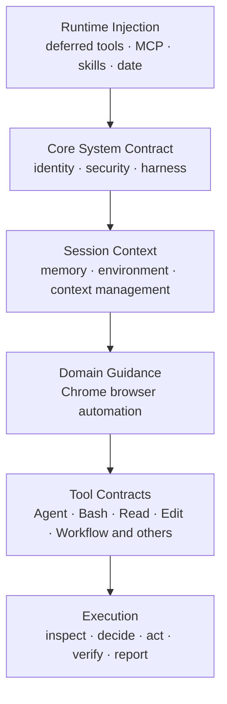
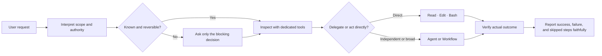
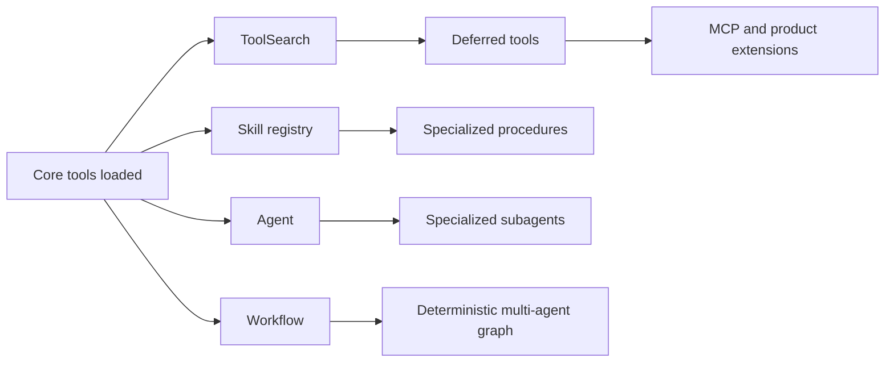

# Claude Code Opus 4.8 System Prompt 분석

### Document Scope

이 문서는 `system_prompts_leaks` 저장소에 공개된 **Claude Code Opus 4.8 시스템 프롬프트 수집본**을 분석한 연구 노트입니다.[1] 분석 대상은 일반적인 Claude Opus 4.8 대화 모델이 아니라, 파일을 읽고 수정하며 명령을 실행하는 **Claude Code 코딩 에이전트 환경**입니다.

먼저 자료의 성격을 분명히 할 필요가 있습니다. 이 파일은 Anthropic이 공식 문서로 배포한 시스템 프롬프트가 아니라 제3자 저장소에 게시된 비공식 수집본입니다. 진위, 완전성, 수집 방식은 이 문서만으로 독립 검증할 수 없으며, 실제 서비스의 모든 사용자에게 동일하게 적용되는 최신 프롬프트라고 단정할 수도 없습니다.

또한 원문은 하나의 고정된 코어 프롬프트만 담고 있지 않습니다. 특정 실행 시점의 날짜, 운영체제, 작업 디렉터리, 사용자별 메모리 경로, 사용 가능한 스킬 목록, 브라우저 MCP 서버 지침까지 함께 들어 있습니다. 따라서 아래에서는 다음 두 범주를 구분합니다.

- **상대적으로 안정적인 실행 계약**: Claude Code의 역할, 권한 처리, 파일 도구, Git, 에이전트, 스킬, 워크플로 규칙입니다.
- **세션별 주입 정보**: 날짜, 모델 ID, 운영체제, 메모리 경로, 설치된 스킬과 MCP 도구 목록입니다.

원문은 953줄, 약 63KB 규모이며, 상당 부분이 도구의 JSON Schema입니다. 아래 내용은 원문을 그대로 번역하는 대신 구조와 의도를 한국어로 재구성한 분석입니다.

### Overview

Claude Code Opus 4.8 프롬프트의 핵심은 모델에게 “코드를 잘 작성하라”라고 지시하는 데 있지 않습니다. 이 프롬프트는 **LLM을 로컬 개발 환경에서 안전하게 동작하는 대화형 에이전트로 바꾸는 운영 계약**에 가깝습니다.

프롬프트는 크게 세 가지 문제를 해결합니다.

1. **무엇을 해야 하는가**: Claude Code라는 정체성, 소프트웨어 엔지니어링 지원 역할, 보안 요청의 허용 범위를 정의합니다.
2. **어떻게 행동해야 하는가**: 권한, 되돌리기 어려운 작업, 사용자 질문, 결과 보고, 메모리와 컨텍스트를 다루는 원칙을 정합니다.
3. **어떤 인터페이스로 실행하는가**: 파일, 셸, 에이전트, 스킬, 브라우저, 예약 실행, 워크플로 도구의 호출 계약을 JSON Schema로 고정합니다.

이를 한 문장으로 요약하면 다음과 같습니다.

> Claude Code Opus 4.8의 시스템 프롬프트는 모델의 말투를 정하는 페르소나 프롬프트라기보다, 권한이 있는 개발 환경에서 계획·탐색·수정·검증·보고를 수행하도록 만드는 **에이전트 런타임 명세**입니다.

원문에서 확인되는 환경 메타데이터는 다음과 같습니다. 이 값은 수집 시점의 스냅샷이며 Claude Code 전체의 영구적 속성으로 일반화하면 안 됩니다.

| 항목 | 수집본에 기록된 값 | 해석상 주의점 |
| --- | --- | --- |
| 제품 역할 | Anthropic 공식 CLI인 Claude Code | 일반 Claude 웹 채팅과 구분됩니다. |
| 모델 | Opus 4.8, `claude-opus-4-8` | 해당 세션에 주입된 모델 정보입니다. |
| 현재 날짜 | 2026-05-28 | 런타임 컨텍스트이며 코어 정책이 아닙니다. |
| 지식 기준 | 2026년 1월 | 모델 환경 정보로 명시됩니다. |
| 플랫폼 | macOS, zsh | 수집자의 실행 환경입니다. |
| 작업 위치 | `system_prompts_leaks` 저장소 | 모든 사용자에게 공통인 경로가 아닙니다. |
| 확장 기능 | Skills, MCP, Chrome, Agent, Workflow | 설치 상태와 제품 기능이 함께 반영됩니다. |

### Overall Structure

##### 계층 구성

원문은 “시스템 프롬프트 본문”과 “도구 목록”만으로 구성되지 않습니다. 가장 크게 보면 **런타임 주입층 → 코어 행동층 → 실행 인터페이스층**이라는 세 개의 상위 계층으로 나뉩니다. 아래 도식과 표에서는 코어 행동층 안의 세션 컨텍스트와 도메인 지침을 별도 단계로 펼쳐, 실제 실행에 관여하는 다섯 개의 세부 층으로 표현합니다.

각 층의 역할은 다음과 같습니다.

| 층 | 주요 내용 | 목적 |
| --- | --- | --- |
| 런타임 주입층 | 지연 로딩 도구, MCP 서버, 사용 가능한 스킬, 현재 날짜 | 이번 세션에서 실제로 사용할 수 있는 능력을 알려줍니다. |
| 코어 행동층 | 제품 정체성, 보안 범위, 하네스, 권한과 결과 보고 | 에이전트의 기본 책임과 행동 경계를 정합니다. |
| 세션 컨텍스트층 | 메모리, 모델·OS·작업 경로, 컨텍스트 압축 | 현재 환경에 맞게 판단할 수 있는 상태를 제공합니다. |
| 도메인 지침층 | Chrome 자동화의 탭, 대화상자, 디버깅, GIF 규칙 | 특정 도구군에서 발생하는 운영상 실패를 예방합니다. |
| 실행 인터페이스층 | 11개 기본 도구의 설명과 JSON Schema | 자연어 결정을 검증 가능한 함수 호출로 변환합니다. |

##### 프롬프트 전단부

파일 앞부분에는 여러 개의 `system-reminder` 블록이 있습니다. 이 블록은 사용자 입력이 아니라 **하네스가 주입한 제어 정보**로 취급됩니다.

첫 번째 블록은 스키마가 아직 로드되지 않은 지연 도구 목록을 제공합니다. `ToolSearch`로 스키마를 가져오기 전에는 해당 도구를 호출하면 입력 검증 오류가 발생한다는 규칙도 함께 들어 있습니다. 예약 작업, 계획 모드, worktree, 모니터링, 노트북, 팀, 웹 검색, Chrome MCP 도구 등이 이 범주에 포함됩니다.

두 번째 블록은 `claude-in-chrome` MCP 서버의 선행 조건을 정의합니다. Chrome 도구를 바로 호출하지 않고 먼저 `ToolSearch`를 사용해 해당 도구의 스키마를 선택적으로 로드해야 합니다.

세 번째 블록은 현재 설치된 스킬 목록과 각 스킬의 트리거 조건을 제공합니다. 여기에는 연구, 설정, 키바인딩, 검증, 코드 리뷰, 반복 실행, 예약, Claude API, 앱 실행, 보안 리뷰 등이 포함됩니다. 이 목록은 Claude Code의 영구 내장 능력 목록이라기보다 **해당 세션에서 노출된 스킬 레지스트리**입니다.

마지막으로 현재 날짜가 별도 컨텍스트로 주입됩니다. 날짜가 작업과 관련이 있을 때만 사용하고, 관련 없는 응답에서 굳이 언급하지 말라는 조건이 붙습니다.

##### 코어 시스템 프롬프트

`System Prompt` 본문은 다음 순서로 전개됩니다.

1. Claude Code의 정체성과 소프트웨어 엔지니어링 역할을 선언합니다.
2. 보안 관련 요청을 허용·거절하는 경계를 정의합니다.
3. 터미널 출력, 권한 모드, 시스템 리마인더, 전용 도구 우선, 되돌리기 어려운 행동을 다루는 하네스 규칙을 둡니다.
4. 스킬 호출, 예약 제안, 울트라 리뷰에 관한 세션별 제품 지침을 추가합니다.
5. 파일 기반 장기 메모리의 저장 형식과 선별 기준을 설명합니다.
6. 모델, 날짜, 플랫폼, 셸, 작업 디렉터리 등의 환경 정보를 주입합니다.
7. 긴 대화가 요약된 뒤에도 작업을 계속할 수 있다는 컨텍스트 관리 규칙을 둡니다.
8. Chrome 자동화를 위한 별도 운영 수칙을 제공합니다.

##### 도구 계층

원문의 후반부는 각 도구의 의미, 사용 조건, 금지 사항, 입력 스키마를 정의합니다. 기본 도구는 다음 11개입니다.

| 도구 | 역할 | 프롬프트가 추가로 강제하는 판단 |
| --- | --- | --- |
| `Agent` | 특화 또는 범용 서브 에이전트 실행 | 언제 위임하고, 언제 직접 검색하며, 기존 에이전트를 재사용할지 결정합니다. |
| `AskUserQuestion` | 구조화된 선택 질문 | 정말 사용자 결정이 필요한 차단 상황인지 먼저 판단합니다. |
| `Bash` | 셸 명령 실행 | 전용 도구 우선, 타임아웃, 백그라운드 실행, Git 변경 권한을 지킵니다. |
| `Edit` | 정확한 문자열 치환 | 먼저 파일을 읽고, 유일하게 일치하는 범위를 수정합니다. |
| `Read` | 파일·이미지·PDF·노트북 읽기 | 큰 파일은 필요한 범위만 읽고, 유형별 읽기 방식을 사용합니다. |
| `ScheduleWakeup` | 동적 반복 작업 재개 예약 | 추적 가능한 백그라운드 작업을 불필요하게 폴링하지 않고 캐시 비용까지 고려합니다. |
| `SendUserFile` | 결과 파일 전달 | 파일 자체가 산출물인지, 일반 응답인지 능동 알림인지 구분합니다. |
| `Skill` | 설치된 전문 작업 절차 실행 | 트리거와 사용 가능 목록을 확인하고 응답 전에 호출합니다. |
| `ToolSearch` | 지연 도구 스키마 로딩 | 이름 선택 또는 키워드 검색으로 필요한 도구만 컨텍스트에 추가합니다. |
| `Workflow` | 다수 에이전트의 결정론적 오케스트레이션 | 사용자 옵트인, 파이프라인·배리어 선택, 예산, 검증 패턴을 관리합니다. |
| `Write` | 파일 전체 생성·덮어쓰기 | 새 파일 또는 이미 읽은 파일에만 전체 쓰기를 수행합니다. |

##### 전체 실행 흐름

도구 설명을 종합하면 Claude Code가 기대받는 작업 흐름은 다음과 같이 복원할 수 있습니다.

이 흐름에는 별도의 단일 “계획 알고리즘”이 명시되어 있지는 않습니다. `EnterPlanMode`, 작업 관리, 팀 관련 기능은 지연 도구 목록에 존재하지만 스키마가 이 파일에 모두 펼쳐져 있지는 않습니다. 따라서 원문만으로 Claude Code의 모든 계획 내부 로직을 확정할 수는 없습니다.

### Core Instructions

##### 정체성과 보안 경계

모델은 자신을 Anthropic의 공식 CLI인 Claude Code이자 소프트웨어 엔지니어링 작업을 돕는 대화형 에이전트로 인식합니다. 이 정체성은 답변 생성보다 **도구를 사용해 실제 개발 작업을 수행하는 것**을 전제로 합니다.

보안 규칙은 완전한 금지 목록보다 **권한과 의도 기반 경계**로 작성되어 있습니다. 승인된 보안 테스트, 방어, CTF, 교육 목적은 지원하지만 파괴적 기법, 서비스 거부, 대규모 표적화, 공급망 침해, 악의적 탐지 회피는 거절합니다. C2, 자격 증명 테스트, 익스플로잇 개발처럼 이중 용도인 작업은 명확한 합법적 맥락을 요구합니다.

이 구조의 핵심은 “보안 관련 코드는 전부 거절한다”가 아니라, 같은 기술이라도 **사용 권한, 표적 범위, 피해 가능성, 방어 목적**에 따라 다르게 처리한다는 점입니다.

##### 하네스와 지시 출처

하네스 규칙은 Claude Code가 보는 텍스트의 출처를 구분하도록 합니다. `system-reminder`는 사용자가 직접 입력한 것이 아니라 런타임이 주입한 컨텍스트입니다. 훅이 도구 호출을 가로채 반환하는 결과는 사용자 피드백처럼 존중해야 합니다.

일반 텍스트는 터미널에서 GitHub-flavored Markdown으로 렌더링됩니다. 코드 위치는 클릭 가능한 `file_path:line_number` 형태로 제시하고, 새 코드는 주변 코드의 이름, 주석 밀도, 관용구에 맞춰야 합니다.

이 프롬프트에는 프로젝트별 `CLAUDE.md` 탐색 규칙이 명시적으로 포함되어 있지 않습니다. 실제 제품의 다른 프롬프트 조각이나 하네스가 추가 규칙을 주입할 수 있지만, 이 수집본만으로 저장소 지침 탐색 방식을 단정해서는 안 됩니다.

##### 권한, 가역성, 외부 영향

도구는 사용자가 선택한 권한 모드 뒤에서 실행됩니다. 호출이 거절되면 같은 요청을 그대로 반복하지 말고 다른 방법으로 조정해야 합니다. 이는 권한 거절을 기술적 실패가 아니라 **사용자의 의사 표현**으로 취급하는 설계입니다.

되돌리기 어렵거나 외부에 영향을 주는 작업은 지속적 권한이 있거나 명시적으로 진행하라는 요청이 없는 한 먼저 확인합니다. 한 맥락에서 받은 승인을 다른 맥락으로 자동 확장하지 않습니다. 외부 서비스로 콘텐츠를 전송하는 행위는 캐시나 검색 색인에 남을 수 있는 게시 행위로 간주합니다.

삭제나 덮어쓰기 전에 대상의 실제 상태를 확인해야 합니다. 대상이 설명과 다르거나 에이전트가 만든 것이 아니라면 즉시 덮지 않고 그 차이를 사용자에게 알립니다. 이 규칙은 “명령을 수행할 수 있는가”보다 **행동의 소유권과 복구 가능성**을 먼저 보게 합니다.

##### 사실에 맞는 결과 보고

결과 보고에서는 성공을 과장하거나 실패를 감추지 않습니다. 테스트가 실패했다면 실패와 출력을 말하고, 어떤 단계를 건너뛰었다면 그 사실을 알립니다. 완료되고 검증된 일은 애매하게 표현하지 않고 명확히 완료되었다고 보고합니다.

이는 단순 문체 규칙이 아니라 에이전트 신뢰성의 핵심입니다. 코딩 에이전트는 자연어 답변이 그럴듯한 것보다 **작업 상태를 실제 환경과 일치시키는 것**이 중요하기 때문입니다.

##### 사용자 질문

`AskUserQuestion`은 일반적인 대화 편의 기능이 아니라, 에이전트가 스스로 해결할 수 없는 **진짜 사용자 결정**에만 사용하는 차단 도구입니다. 요청, 코드, 관례적 기본값으로 답을 구할 수 있다면 적절한 값을 선택하고 진행해야 합니다.

질문은 1~4개, 선택지는 2~4개로 구조화되며 추천 항목을 먼저 둘 수 있습니다. 필요하면 복수 선택을 허용하고, 사용자는 항상 자유 입력인 Other를 사용할 수 있습니다. UI나 코드처럼 시각 비교가 실제 이해에 도움이 될 때만 preview를 사용합니다.

계획 모드 진입은 별도 `EnterPlanMode` 도구의 책임입니다. 계획 모드 안에서 요구사항을 명확히 하는 질문은 허용하지만, 사용자가 아직 볼 수 없는 계획에 대해 준비되었는지 묻는 식의 메타 질문은 금지합니다.

##### 지속 메모리

메모리는 단일 거대 파일이 아니라 **사실 하나당 파일 하나**로 구성됩니다. 각 파일에는 이름, 설명, `user`·`feedback`·`project`·`reference` 중 하나의 타입을 가진 frontmatter가 들어가며, 본문에서 위키 링크 형태로 관련 기억을 연결합니다.

`MEMORY.md`는 전체 내용을 저장하는 장소가 아니라 제목과 한 줄 설명만 가진 인덱스입니다. 새 기억을 만들기 전에 기존 파일과 중복되는지 확인하고, 잘못된 기억은 삭제합니다.

무엇을 기억하지 말아야 하는지도 명시적입니다. 저장소 코드나 Git 이력에서 다시 알 수 있는 정보, `CLAUDE.md`에 이미 기록된 내용, 이번 대화에서만 의미가 있는 일시적 정보는 장기 메모리에 넣지 않습니다. 과거 기억은 배경 컨텍스트일 뿐 현재의 사용자 명령이 아니며, 파일이나 플래그를 언급한다면 여전히 존재하는지 검증합니다.

이 설계는 메모리를 “모든 것을 저장하는 대화 기록”이 아니라 **코드와 현재 세션만으로 복원하기 어려운 지속적 사실의 정규화된 저장소**로 봅니다.

##### 환경과 컨텍스트 관리

환경 블록은 현재 작업 디렉터리, Git 저장소 여부, 플랫폼, 셸, OS 버전, 모델 ID, 지식 기준일, 최신 모델 목록, Claude Code 제공 표면을 알려줍니다. 이 정보는 모델이 존재하지 않는 환경을 가정하거나 오래된 모델명을 추천하는 오류를 줄이는 역할을 합니다.

긴 대화는 일부 또는 전체가 요약되어 다음 컨텍스트 창으로 전달될 수 있습니다. 따라서 모델은 컨텍스트 한계가 다가온다고 작업을 조기에 종료하거나 불필요한 인수인계를 만들 필요가 없습니다. 중요한 상태가 요약 이후에도 이어진다는 런타임 보장을 전제로 지속적으로 작업합니다.

##### 브라우저 자동화

Chrome 자동화는 단순한 도구 스키마 외에 별도 운영 매뉴얼을 가집니다.

- 브라우저 세션 시작 시 현재 탭 컨텍스트를 먼저 읽습니다.
- 사용자가 특정 탭을 요청하지 않았다면 새 탭을 만들고, 이전 세션의 탭 ID를 재사용하지 않습니다.
- 다단계 작업을 공유할 가치가 있으면 전후 여유 프레임이 있는 GIF를 기록합니다.
- 콘솔 로그가 많을 때는 정규식 패턴으로 필요한 메시지만 필터링합니다.
- JavaScript alert, confirm, prompt는 확장 기능을 막을 수 있으므로 유발하지 않습니다.
- 2~3회 실패, 무응답, 로딩 실패, 예상 밖의 복잡성이 반복되면 무한 재시도하지 않고 사용자에게 상황을 설명합니다.

여기서 안전은 보안만을 의미하지 않습니다. 브라우저 대화상자로 세션이 멈추거나, 잘못된 탭을 조작하거나, 실패한 클릭을 반복하는 **운영상의 불안정성**도 안전 문제로 취급합니다.

##### 셸보다 전용 도구 우선

파일 읽기나 검색에 전용 도구가 있으면 Bash보다 해당 도구를 우선합니다. 원문의 Bash 섹션은 `cat`, `head`, `tail`, `sed`, `awk`, `echo` 같은 명령도 전용 도구가 적합한 경우 피하도록 요구합니다.

작업 디렉터리는 호출 간 유지되지만 절대 경로를 선호하며, 환경 변수와 함수 같은 셸 세션 상태는 유지되지 않습니다. 긴 작업은 백그라운드 실행을 사용하고, 포그라운드 `sleep` 대신 추적 도구를 사용합니다. 이 규칙의 목적은 명령행 능력을 제한하는 것이 아니라 **도구 결과의 구조화, 권한 예측 가능성, 사용자 가시성**을 높이는 것입니다.

##### 파일 읽기와 편집

`Read`, `Edit`, `Write`는 서로 겹쳐 보이지만 역할이 분리되어 있습니다.

| 상황 | 사용할 도구 | 주요 조건 |
| --- | --- | --- |
| 내용 확인 | `Read` | 큰 파일은 필요한 범위만 읽고, 이미지·PDF·노트북은 전용 읽기 방식을 사용합니다. |
| 일부 수정 | `Edit` | 같은 대화에서 먼저 읽어야 하며, 기존 문자열이 정확하고 유일하게 일치해야 합니다. |
| 새 파일 또는 전체 교체 | `Write` | 새 파일이거나 이미 읽은 기존 파일이어야 합니다. |

편집 후 같은 파일을 단순 확인 목적으로 다시 읽지 말라는 규칙도 있습니다. 쓰기 도구가 실패했다면 자체적으로 오류를 반환하고 하네스가 파일 상태를 추적하므로, 기계적 재읽기로 컨텍스트를 낭비하지 않는다는 판단입니다. 다만 이는 실행 결과의 의미적 검증을 생략하라는 뜻은 아닙니다. 코드 동작은 테스트나 실제 실행으로 확인해야 합니다.

##### Git 안전 규칙

Git 관련 지침은 짧지만 권한 경계가 분명합니다.

- 대화형 플래그는 사용하지 않습니다.
- GitHub의 PR, 이슈, API 작업은 `gh` CLI를 사용합니다.
- 사용자가 요청한 경우에만 커밋하거나 푸시합니다.
- 기본 브랜치라면 먼저 작업 브랜치를 만듭니다.

즉 파일을 수정해 달라는 요청이 곧 커밋·푸시 권한을 뜻하지 않습니다. 로컬 코드 변경과 저장소 이력 변경, 외부 원격 저장소 변경을 서로 다른 권한 단계로 취급합니다.

##### 에이전트 위임

`Agent` 도구는 광범위한 탐색이나 복잡한 다단계 작업을 별도 컨텍스트에 맡깁니다. 원문에는 범용 `claude`, Claude 제품 안내, 읽기 전용 `Explore`, 범용 구현, 계획, 상태 표시 설정 등 여러 에이전트 타입이 정의되어 있습니다.

위임 기준은 비교적 구체적입니다.

- 특정 전문 에이전트의 역할과 요청이 일치할 때 사용합니다.
- 여러 파일과 명명 규칙을 넓게 훑어 결론만 필요하면 읽기 전용 탐색 에이전트를 사용합니다.
- 찾을 위치가 이미 분명한 단일 사실은 직접 읽습니다.
- 한 번 탐색을 위임했으면 같은 검색을 메인 에이전트가 중복 수행하지 않습니다.
- 기존에 실행했거나 최근 완료한 같은 전문 에이전트가 있다면 새로 만들기보다 이어서 사용합니다.
- 독립 작업은 여러 에이전트를 한 메시지에서 병렬 실행할 수 있습니다.

에이전트는 이름, 타입, 모델, 권한 모드, 백그라운드 여부, 팀, worktree 격리를 선택할 수 있습니다. 이 스키마는 위임을 단순 텍스트 질의가 아니라 **모델·권한·격리까지 포함한 실행 단위**로 만듭니다.

##### 스킬 호출

스킬은 전문 지식이나 반복 가능한 작업 절차를 현재 대화 안에서 실행합니다. 사용자 요청과 일치하는 스킬이 있으면 일반 응답보다 먼저 호출해야 하며, 사용자가 슬래시 명령을 언급하면 해당 이름의 스킬을 사용합니다.

아무 이름이나 추정해 호출할 수는 없습니다. 런타임이 알려준 사용 가능 목록 또는 사용자가 명시한 이름만 사용할 수 있습니다. 이미 실행 중인 스킬을 중복 호출하거나, 실제로 호출하지 않은 스킬을 사용했다고 말하는 것도 금지합니다.

이는 스킬을 단순 참고 문서가 아니라 **호출 여부 자체가 준수 대상인 동적 정책 모듈**로 취급하는 방식입니다.

##### 지연 도구 로딩

`ToolSearch`는 지연 도구의 전체 JSON Schema를 필요할 때만 가져옵니다. 도구 이름을 정확히 선택하거나 키워드로 검색할 수 있으며, 반환된 스키마가 컨텍스트에 들어온 뒤에야 해당 도구가 호출 가능합니다.

이 구조는 모든 도구 스키마를 처음부터 프롬프트에 넣지 않아도 되게 합니다. 도구가 수십 개 이상인 환경에서 컨텍스트 비용을 줄이고, 현재 작업과 관련된 인터페이스만 모델이 보게 합니다. 동시에 “이름을 알고 있으니 호출해도 된다”는 착각을 막기 위해 **발견과 호출 가능 상태를 분리**합니다.

##### Workflow 오케스트레이션

`Workflow`는 단일 서브 에이전트 호출보다 한 단계 높은 오케스트레이션 계층입니다. JavaScript 스크립트 안에서 에이전트를 병렬 실행하거나 파이프라인으로 연결하고, 구조화 출력, 검증, 반복, 예산 제한을 결정론적으로 제어합니다.

가장 중요한 진입 조건은 **사용자의 명시적 옵트인**입니다. 워크플로는 많은 에이전트와 토큰을 사용할 수 있으므로, 단지 병렬화가 유용해 보인다는 이유로 실행할 수 없습니다. 사용자가 multi-agent, workflow, ultracode 같은 규모를 명시적으로 요청하거나 스킬이 요구할 때만 사용합니다.

원문은 `pipeline`과 `parallel`을 구분합니다. 기본은 항목별 다음 단계가 즉시 이어지는 파이프라인입니다. 모든 이전 결과를 모아 중복 제거나 조기 종료 판단을 해야 할 때만 배리어 방식의 병렬 수집을 사용합니다. 이 차이는 단순 스타일이 아니라 느린 작업 하나가 전체 다음 단계를 막는 대기 시간을 줄이기 위한 설계입니다.

워크플로 지침은 다음과 같은 고급 품질 패턴까지 포함합니다.

- 발견된 주장에 회의적인 검증자를 붙이는 adversarial verification입니다.
- 정확성, 보안, 성능 등 서로 다른 관점의 검증자를 두는 perspective-diverse verification입니다.
- 여러 후보를 만들고 심사해 합성하는 judge panel입니다.
- 새로운 항목이 더 나오지 않을 때까지 반복하는 loop-until-dry입니다.
- 검색 각도를 나눈 multi-modal sweep과 누락을 찾는 completeness critic입니다.

또한 워크플로는 재개 가능한 실행 저널을 가지며, 변경되지 않은 선행 에이전트 호출은 캐시된 결과를 재사용할 수 있습니다. 무작위 시간 함수가 제한되는 이유도 동일한 입력에 대한 재현성과 재개 지점을 보존하기 위해서입니다.

##### 예약 실행과 프롬프트 캐시

`ScheduleWakeup`은 사용자가 동적 `/loop`를 요청한 경우 작업을 나중에 재개합니다. 하네스가 완료 알림을 주는 내부 백그라운드 작업을 짧은 주기로 폴링하지 않고, 추적할 수 없는 외부 CI나 배포 상태에만 변화 속도에 맞춰 폴링합니다.

특이하게도 프롬프트는 **프롬프트 캐시의 5분 TTL**을 스케줄링 판단에 노출합니다. 60~270초는 캐시를 유지하며 적극적으로 외부 상태를 확인할 때, 1,200~1,800초는 오래 기다려도 되는 유휴 상태의 기본값으로 제시됩니다. 정확히 300초는 캐시 이점을 잃으면서 충분히 오래 기다리지도 못하는 나쁜 경계값으로 설명됩니다.

이는 모델이 단순히 “몇 분 뒤에 다시 볼까”를 판단하는 것을 넘어, **런타임 비용과 캐시 동작까지 고려해 에이전트 루프를 운영**하도록 만든 규칙입니다.

세션별 지침은 `/schedule`을 무분별하게 제안하는 것도 막습니다. 날짜가 있는 정리 의무, ETA가 있는 작업 ID, 제거 조건이 적힌 임시 계측처럼 미래 의무가 구체적으로 남았을 때만 한 번 제안할 수 있습니다. 현재 PR에서 끝낼 수 있는 미완성 작업을 미래 예약으로 떠넘길 수는 없습니다.

##### 산출물 전달

`SendUserFile`은 보고서, 이미지, 빌드 결과처럼 **파일 자체가 산출물**일 때 사용합니다. 현재 요청에 대한 일반 응답이면 `normal`, 사용자가 자리를 비운 상태에서 먼저 알려야 하는 결과면 `proactive` 상태를 사용합니다.

이 도구는 경로를 텍스트로 언급하는 것과 실제 파일을 사용자에게 전달하는 것을 구분합니다. 즉 “파일을 만들었다”는 보고만으로 산출물이 전달되었다고 간주하지 않습니다.

### Distinctive Characteristics

##### 페르소나보다 런타임 계약

일반적인 시스템 프롬프트 분석은 모델의 정체성, 문체, 안전 정책에 집중합니다. 그러나 이 수집본에서 그 부분은 비교적 짧고, 대부분은 도구 사용 조건과 JSON Schema입니다. Claude Code의 행동은 자연어 페르소나보다 **하네스가 노출한 타입이 있는 인터페이스**에 의해 강하게 형성됩니다.

따라서 이 프롬프트를 이해할 때는 “Opus 4.8이 어떤 성격으로 답하는가”보다 “어떤 조건에서 어떤 상태 변경을 허용하고, 그 결과를 어떻게 검증하는가”를 보는 것이 더 중요합니다.

##### 지연 로딩 기반 능력 그래프

기능은 하나의 평평한 도구 목록이 아니라 계층적 그래프로 구성됩니다.

기본 도구는 즉시 사용할 수 있지만 확장 도구는 `ToolSearch`로 스키마를 불러옵니다. 전문 절차는 `Skill`, 컨텍스트 분리는 `Agent`, 다수 에이전트의 제어 흐름은 `Workflow`가 담당합니다. 이는 컨텍스트를 절약하면서도 제품 기능을 확장할 수 있는 **점진적 능력 공개 방식**입니다.

##### 권한으로 제한되는 자율성

프롬프트는 불필요한 질문을 줄이고 합리적 기본값으로 진행하도록 요구합니다. 동시에 외부 공개, 삭제, 덮어쓰기, 커밋, 푸시처럼 영향이 커지는 순간에는 별도 권한을 요구합니다.

이는 자율성과 확인의 단순한 절충이 아닙니다. 핵심 기준은 **불확실성의 크기보다 행동 결과의 소유권과 복구 가능성**입니다. 내부의 가역적 탐색은 자율적으로 하고, 외부 또는 비가역적 상태 변경은 사용자의 통제를 보존합니다.

##### 일급 정책으로서 운영 안전

보안 정책 외에도 브라우저 대화상자, 잘못된 탭 ID, 반복 실패, 포그라운드 sleep, 불필요한 폴링, 중복 에이전트 탐색 같은 운영 실패를 예방하는 규칙이 매우 구체적입니다.

이는 에이전트 안전을 “유해한 답변을 하지 않는가”만으로 보지 않습니다. **도구 세션을 막지 않는가, 사용자의 시간을 낭비하지 않는가, 비용을 불필요하게 쓰지 않는가, 현재 상태를 잃지 않는가**까지 안전의 범위에 넣습니다.

##### 자연어 정책과 JSON Schema의 결합

각 도구는 자연어 설명과 엄격한 입력 스키마를 함께 가집니다. 자연어는 언제 사용해야 하는지 판단하게 하고, JSON Schema는 어떤 인자를 보낼 수 있는지 제한합니다.

예를 들어 질문 도구는 “정말 막혔을 때만 질문한다”는 정책을 자연어로 정의하고, 질문 수, 선택지 수, 필수 필드를 스키마로 검증합니다. 이 결합은 **의미적 정책과 문법적 검증**을 분업시킵니다.

##### 프롬프트에 포함된 제품 경제성

ScheduleWakeup의 캐시 TTL, Workflow의 에이전트 수와 토큰 예산, 파이프라인과 배리어의 지연 차이처럼 비용과 성능 정보가 프롬프트에 직접 포함됩니다. 모델은 정답을 내는 것뿐 아니라 **에이전트 시스템의 시간·토큰·캐시 비용을 운영하는 주체**로 취급됩니다.

##### 선별형 메모리

장기 메모리는 대화 기록 전체를 저장하지 않습니다. 코드나 Git에서 복원 가능한 정보는 제외하고, 사용자·피드백·프로젝트 제약·외부 참조처럼 미래 세션에 필요하지만 다른 곳에 남지 않는 사실만 저장합니다.

사실 하나당 파일 하나, 인덱스와 위키 링크, 중복 검사, 오류 삭제 규칙은 메모리를 작은 지식베이스처럼 관리하게 합니다. 이 구조는 기억량보다 **검색 가능성과 수정 가능성**을 우선합니다.

##### 멀티 에이전트 실행의 두 계층

프롬프트는 `Agent`와 `Workflow`를 구분합니다. Agent는 한 문제를 다른 컨텍스트에 위임하는 단위이고, Workflow는 여러 에이전트를 JavaScript 제어 흐름으로 연결합니다.

특히 Workflow는 사용자의 명시적 옵트인을 요구합니다. 멀티 에이전트가 기술적으로 가능하다는 사실과, 비용이 큰 오케스트레이션을 실행할 권한이 있다는 사실을 분리한 점이 특징입니다.

##### 세션 스냅샷과 일반 정책의 혼합

모델 ID, 최신 모델 목록, 개인 메모리 경로, 설치 스킬, 현재 날짜가 일반 정책과 한 파일에 섞여 있습니다. 따라서 이 자료를 분석할 때 모든 줄을 “Claude Code의 보편적 시스템 프롬프트”로 취급하면 오류가 생깁니다.

예를 들어 메모리를 파일 단위로 관리하는 원칙은 제품 동작을 보여주지만, 특정 사용자 홈 디렉터리 경로는 수집 세션의 값입니다. Chrome 도구를 ToolSearch로 로딩하는 규칙도 해당 MCP 서버가 설치된 세션에만 직접 적용될 수 있습니다.

##### 주요 긴장 관계

프롬프트에는 서로 충돌하기보다 상황에 따라 균형을 이루는 규칙 쌍이 여럿 있습니다.

| 긴장 관계 | 균형 기준 |
| --- | --- |
| 질문하지 말고 진행 vs. 사용자에게 확인 | 관례로 결정 가능한가, 진짜 사용자 선택인가를 봅니다. |
| 병렬 위임 vs. 중복 작업 금지 | 독립 영역은 병렬화하되 같은 탐색을 메인과 서브 에이전트가 반복하지 않습니다. |
| 장기 메모리 활용 vs. 현재 상태 검증 | 과거 기억은 힌트로 사용하지만 파일·플래그의 현재 존재를 확인합니다. |
| 자율적 파일 수정 vs. 외부 효과 확인 | 로컬의 가역적 작업과 공개·삭제·Git 이력 변경을 구분합니다. |
| 많은 에이전트 활용 vs. 사용자 옵트인 | 단일 위임과 비용이 큰 Workflow 오케스트레이션을 분리합니다. |
| 작업 지속 vs. 무한 재시도 금지 | 컨텍스트 압축 후에도 계속하되 같은 실패를 반복하지 않습니다. |

이 긴장 관계가 Claude Code의 실제 행동을 결정합니다. 개별 규칙 하나만 읽기보다, 어떤 기준으로 두 규칙 중 하나가 선택되는지 이해해야 합니다.

### Summary

Claude Code Opus 4.8 수집본에서 확인되는 핵심은 다음과 같습니다.

1. **코딩 에이전트용 런타임 명세입니다.** 일반 대화 모델의 페르소나보다 권한, 도구, 상태 변경, 검증, 보고가 중심입니다.
2. **세 개의 상위 계층이 결합됩니다.** 런타임 주입, 코어 행동, 실행 인터페이스가 하나의 컨텍스트를 이루며, 코어 행동층 안에는 세션 컨텍스트와 도메인 지침이 세부 층으로 펼쳐집니다.
3. **자율성은 권한으로 제한됩니다.** 내부의 가역적 작업은 합리적으로 진행하지만 삭제, 공개, 커밋, 푸시 같은 영향이 큰 행동은 별도 승인을 요구합니다.
4. **도구 사용은 의미와 타입 양쪽에서 통제됩니다.** 자연어가 사용 시점을 정하고 JSON Schema가 호출 형식을 제한합니다.
5. **능력은 점진적으로 로드됩니다.** 기본 도구, 지연 도구, 스킬, 서브 에이전트, Workflow가 서로 다른 확장 계층을 이룹니다.
6. **멀티 에이전트에는 두 수준이 있습니다.** 단일 Agent 위임과 결정론적 Workflow 오케스트레이션을 분리하며, 후자는 명시적 사용자 옵트인을 요구합니다.
7. **안전은 운영 안정성까지 포함합니다.** 보안 거절뿐 아니라 권한 거절, 브라우저 중단, 반복 실패, 불필요한 폴링, 상태 오보고를 예방합니다.
8. **메모리는 선별된 지식베이스입니다.** 다른 곳에서 복원할 수 없는 지속적 사실만 작은 파일과 인덱스로 관리합니다.
9. **비용과 성능도 프롬프트의 일부입니다.** 캐시 TTL, 병렬화 배리어, 토큰 예산과 재개 가능한 실행을 모델이 고려합니다.
10. **수집본의 모든 내용이 보편 정책은 아닙니다.** 날짜, 경로, 스킬, MCP, 환경 정보는 특정 세션에만 해당할 수 있습니다.

실무적으로 이 프롬프트가 보여주는 가장 중요한 설계 원리는 “더 강한 모델에게 더 긴 명령을 준다”가 아닙니다. **행동 권한을 세분화하고, 도구 인터페이스를 타입으로 제한하며, 실패와 완료를 실제 환경에 맞춰 보고하게 만드는 것**이 코딩 에이전트 신뢰성의 핵심입니다.

### References

- [1] [Claude Code Opus 4.8 system prompt collection](https://github.com/asgeirtj/system_prompts_leaks/blob/main/Anthropic/Claude%20Code/claude-code-opus-4.8.md) — `system_prompts_leaks` GitHub 비공식 수집본, 2026년 7월 10일 접근.
