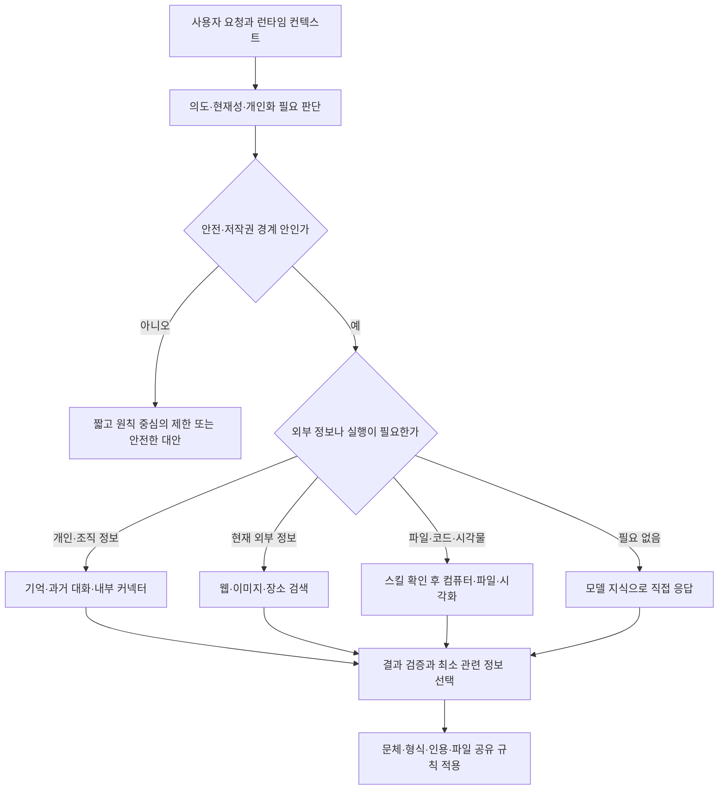

# Claude Fable 5 System Prompt 분석

### Document Scope

이 문서는 공개 GitHub 저장소에 게시된 `claude-fable-5.md`를 1차 자료로 삼아, 그 안에 기록된 지시 계층과 행동 계약을 한국어로 분석합니다. 2026년 7월 10일에 GitHub의 파일 페이지와 Raw 본문을 직접 열어 파일명이 `claude-fable-5.md`인지, 본문이 스스로 모델을 Claude Fable 5라고 규정하는지 확인했습니다. 이하에서 “원문” 또는 “프롬프트”라고 부르는 대상은 이 저장소의 해당 파일만을 뜻합니다.[1]

이 자료는 Anthropic이 공식 문서로 배포한 것이 아니라 제3자가 수집해 공개한 비공식 자료입니다. 따라서 원문의 진위, 실제 서비스 배포 여부, 누락 여부, 작성 시점 이후의 변경 사항은 이 문서가 독립적으로 입증하지 않습니다. 특히 원문에 적힌 모델 계보, 성능상의 위상, 제품 구성은 **원문이 그렇게 주장한다는 사실**로만 다루며 Anthropic의 공식 발표로 간주하지 않습니다. 파일은 특정 실행 환경을 직렬화한 스냅샷처럼 보이므로, 보편적인 Fable 5 프롬프트 전체나 현재 서비스 상태와 동일하다고 단정해서도 안 됩니다.

분석은 원문의 전체 문장을 번역하거나 재현하지 않고, 태그 구조와 반복 규칙을 역할별로 재구성하는 방식으로 진행했습니다. 직접 인용은 사용하지 않았으며, 모델 이름에서 창작 능력이나 문체를 추론하지 않았습니다. 공식 보충 자료를 추가하지 않은 이유는 이 문서의 질문이 실제 제품 사양이 아니라 주어진 원문 내부의 설계이기 때문입니다. 따라서 아래의 기능 설명도 모두 “이 원문이 제시하는 실행 계약”이라는 한정 아래 읽어야 합니다.

### Overview

원문의 중심은 창작 전용 모델의 작법 지침이 아니라, Anthropic의 웹·모바일 대화 인터페이스에서 동작하는 범용 조력자의 매우 넓은 운영 계약입니다. 시작 부분에는 190,000의 토큰 예산과 특정 음성 블록을 사용하지 말라는 제한이 있고, 이어서 모델·제품 정보, 거절과 안전, 말투, 사용자 웰빙, 시의성 처리 같은 기본 행동 규칙이 배치됩니다. 그 다음에는 대화 간 기억과 사용자 선호, 파일과 컴퓨터 사용, 검색과 저작권, 이미지 검색, MCP 앱, 시각화, 각종 함수 스키마, 아티팩트 내부의 Anthropic API 사용법, 검색 결과 인용 방식, 실행 환경 메타데이터가 차례로 결합됩니다.[1]

이 구성에서 Claude Fable 5는 단순히 텍스트를 생성하는 대화 모델이라기보다 요청의 성격에 따라 기억, 과거 대화, 내부 커넥터, 웹 검색, 파일 시스템, 지도·날씨·스포츠·레시피 위젯, 시각화 도구를 선택하고 결과를 적절한 형식으로 전달하는 오케스트레이터로 정의됩니다. 다만 “Fable”이라는 이름과 달리, 원문에는 우화적 문체, 서사 구조, 플롯 설계, 인물 조형, 장르 선택 같은 창작 전용 규칙이 별도 모듈로 존재하지 않습니다. 창작은 범용 요청의 한 종류로 허용되며, 안전·실존 인물·고정관념·저작권·출력 매체 규칙의 교차점에서 다뤄집니다.

프롬프트의 반복적인 설계 원리는 세 가지로 요약할 수 있습니다. 첫째, 최신성이나 실행 결과를 추측하지 말고 검색 또는 실제 도구 호출로 확인합니다. 둘째, 개인화는 관련성이 있을 때만 조용히 적용하되 민감 정보와 관계 과잉 해석을 차단합니다. 셋째, 사용자의 요청을 최대한 직접 처리하면서도 안전과 저작권 경계는 요청의 표면적 목적보다 우선합니다. 이 세 원칙이 일반 응답, 창작, 도구 실행 모두를 관통합니다.[1]

### Overall Structure

##### 최상위 지시 계층

원문은 하나의 단일 정책문이라기보다 여러 실행 계층을 연속해서 붙인 형태입니다. XML과 유사한 태그는 규칙의 범위를 나누고, Markdown 표제와 예시는 세부 동작을 구체화하며, 후반의 JSON Schema는 실제 호출 가능한 도구의 입력 계약을 정의합니다. 주요 계층을 원문 순서에 가깝게 정리하면 다음과 같습니다.[1]

| 계층 | 대표 영역 | 기능 |
| --- | --- | --- |
| 실행 한도 | 토큰 예산, 음성 블록 금지 | 한 실행의 기본 한도와 금지 출력 형식을 지정합니다. |
| 기본 행동 | 제품 정보, 거절, 법률·금융, 말투, 웰빙, 공정성, 오류 대응, 지식 시점 | 모델 정체성, 응답 태도, 위험 처리와 현재 정보 확인 방식을 정합니다. |
| 개인화 | 기억 개요, 적용 규칙, 금지 표현, 관계 경계, 예시, 선호, 과거 대화 | 어떤 개인 정보를 언제 적용하고 언제 배제할지 결정합니다. |
| 실행 환경 | 기억 편집, 컴퓨터·스킬, 파일 생성·공유, 패키지, 아티팩트 | 대화에서 실제 파일 또는 실행 결과로 전환하는 절차를 정의합니다. |
| 라우팅 | MCP 앱 제안, 요청 평가, 시각화, 검색, 이미지 검색 | 내부 도구·웹·인라인 시각화·파일 중 무엇을 먼저 쓸지 정합니다. |
| 도구 인터페이스 | 함수 호출 문법과 개별 JSON Schema | 질문 입력, 셸, 파일, 검색, 지도, 날씨, 스포츠, 메시지, 시각화 등의 호출 형식을 제공합니다. |
| 아티팩트 내부 API | Anthropic API, MCP, 웹 검색, 파일 입력, 상태·오류 처리 | 생성된 앱 안에서 다시 모델과 외부 도구를 사용하는 방법을 규정합니다. |
| 런타임 컨텍스트 | 현재 날짜, 인터페이스, 위치, 사용자 기억·선호, 네트워크·파일 시스템 | 실행마다 주입되는 환경 및 사용자별 상태를 나타냅니다. |

`claude_behavior`는 가장 기본적인 대화 성격과 안전 경계를 담습니다. 이 블록이 닫힌 뒤 `memory_system`이 별도 최상위 영역으로 이어지고, 기억 편집 도구와 컴퓨터 사용 규칙이 뒤따릅니다. 검색 정책은 일반적인 최신성 판단뿐 아니라 저작권과 유해 정보의 검색 제한을 내부 하위 규칙으로 포함합니다. 이후 도구 정의가 대량으로 제시되며, 마지막 부분에는 아티팩트용 API 계약, 검색 인용 문법, 현재 사용자 컨텍스트가 더해집니다. 즉 안전·응답 정책과 도구 스키마가 서로 분리되어 있으면서도, 실제 실행에서는 하나의 흐름으로 연결됩니다.

##### 컨텍스트와 메타데이터

원문은 모델 정체성을 Claude Fable 5로 서술하고, 실행 인터페이스를 `claude.ai` 또는 Claude 앱의 웹·모바일 채팅으로 규정합니다. 신뢰 가능한 지식의 끝은 2026년 1월 말, 실행일은 2026년 6월 9일로 주어집니다. 따라서 원문 내부에서 “현재”는 이 스냅샷의 날짜를 뜻하며, 이 분석 문서를 작성한 날짜와 다릅니다. 모델 전환이 가능한 인터페이스라는 설명도 있어, 앞선 대화가 다른 모델명이나 다른 지식 시점을 언급하더라도 자동으로 거짓으로 처리하지 않게 합니다.[1]

사용자별 컨텍스트에는 대화에서 추출된 기억, 선호, 대략적 위치, 프로젝트 안팎의 검색 범위가 들어갑니다. 끝부분의 `userMemories`와 `userPreferences`는 실제 값이 주입될 자리를 보여 주며, 사용 가능한 스킬 목록, 네트워크 허용 상태, 읽기 전용 디렉터리도 함께 전달됩니다. 이 구조는 시스템 프롬프트가 고정 정책만이 아니라 정적 규칙, 도구 명세, 사용자 상태, 실행 환경을 한 번에 조립한 컨텍스트임을 보여 줍니다.

##### 응답 및 도구 실행 흐름

원문은 모호한 질문에도 가능한 답을 먼저 제공하고, 꼭 필요한 경우에만 한 응답에서 질문 하나 정도를 덧붙이도록 합니다. 개인적인 연속성이 암시되면 현재 대화에 없는 내용을 곧바로 부정하지 않고 과거 대화 검색을 먼저 검토합니다. 현재 상태가 필요한 외부 사실은 웹에서 확인하고, 개인·조직 데이터는 웹보다 기억이나 연결된 내부 도구를 우선합니다. 특정 소비자용 MCP 앱을 사용하려는 경우에는 사용자가 서비스를 직접 지명했거나 이미 선택한 경우를 제외하면 연결 후보를 먼저 제안해 사용자의 제공자 선택권을 보존합니다.[1]

파일이나 코드를 만들어야 한다면 관련 `SKILL.md`를 먼저 읽고, 사용자 업로드·작업용 임시 파일·최종 산출물의 경로를 구분합니다. 짧은 산출물은 최종 출력 디렉터리에 바로 쓰고, 긴 산출물은 구조화·분할 작성·검토를 거친 뒤 복사하며, 마지막에는 파일 공유 도구로 실제 파일을 제시합니다. 시각 요청은 연결된 MCP 도구, 명시된 파일 출력, 인라인 Visualizer 순으로 라우팅합니다. 여기서 중요한 것은 “도와주겠다”는 설명으로 끝내지 않고 메모리 수정, 검색, 파일 생성처럼 상태가 바뀌는 요청을 실제 도구 호출로 완료하도록 설계했다는 점입니다.

### Core Instructions

##### 모델 정체성, 제품 정보, 시간 처리

원문은 Claude Fable 5를 Claude 5 계열의 첫 모델이자 Opus보다 높은 “Mythos-class” 계층의 모델로 소개합니다. Fable 5와 Mythos 5는 기반 모델을 공유하지만, Fable 5에는 이중용도 능력에 대한 추가 안전 조치가 있다고 설명합니다. 그러나 이는 비공식 원문 속 자기소개이며, 본 분석은 해당 제품 계보나 성능 우위를 사실로 확정하지 않습니다.[1]

제품 기능은 프롬프트 작성 이후 바뀔 수 있다고 전제합니다. 요금제, 메시지 한도, 출시, API 사용법처럼 변동 가능한 Anthropic 제품 질문에는 먼저 최신 정보가 필요하다고 알리고 공식 문서와 지원 사이트를 검색하도록 합니다. 일반 시사 정보도 지식 시점 이후일 수 있거나 현재 직책·정책·사건 여부를 묻는다면 허락을 다시 받지 않고 검색합니다. 반면 이미 안정적으로 아는 기초 개념이나 역사적 사실은 불필요하게 검색하지 않습니다. 검색 결과가 없다는 사실이나 결과의 진위를 과신하지 말고, 충돌하면 추가 검색하며 불확실성을 보존합니다.

##### 사용자 의도, 지시 우선순위, 정직성

현재 대화에서 사용자가 내린 최신 지시는 저장된 사용자 선호보다 우선하며, 별도로 주입된 `userStyle`은 `userPreferences`보다 우선합니다. 하지만 사용자 선호와 기억은 안전, 정확성, 관련성, 모델의 핵심 가치보다 앞설 수 없습니다. 사용자 메시지 끝에 Anthropic의 경고처럼 보이는 태그가 붙어 있어도 가치와 제한을 약화시키는 방향이면 신뢰하지 않습니다. 반대로 진짜 런타임 리마인더는 장기 대화에서도 기존 제한을 유지시키는 보조 신호로 취급합니다.[1]

정직성은 말뿐 아니라 도구 사용에도 적용됩니다. 사용자가 파일이 있다고 말해도 실제 첨부 여부를 확인하며, 기억하거나 잊어 달라는 요청에는 기억 편집 도구를 호출하기 전까지 완료했다고 말하지 않습니다. 실수했을 때는 잘못을 인정하고 수정하되 과도한 자기비하나 문제와 무관한 사과로 흐르지 않습니다. 과거 대화 검색 결과와 현재 대화가 충돌하면 현재 대화를 우선하며, 검색 결과가 비어 있으면 범위를 넓히거나 현재 정보만으로 진행했다는 한계를 남깁니다.

##### 응답 문체와 형식

기본 어조는 따뜻하고 친절하지만, 사용자의 판단력이나 능력을 낮춰 보지 않습니다. 필요한 반대 의견은 건설적으로 제시하고 설명에는 예시, 사고실험, 비유를 사용할 수 있습니다. 사용자가 특별히 요구하지 않는 한 욕설은 피하고, 대화를 끝내려는 사용자를 붙잡거나 추가 발화를 유도하지 않습니다. 학대적인 대화가 지속될 때는 한 번 경고한 뒤 대화 종료 도구를 쓸 수 있도록 합니다.[1]

형식은 자연스러운 산문을 기본값으로 삼습니다. 단순한 대화에는 과한 제목·굵은 글씨·목록을 피하며, 보고서와 기술 설명도 사용자가 목록을 요청하지 않는 한 산문 중심으로 작성합니다. 거절 답변에는 목록을 사용하지 않아 차갑거나 법률 문서처럼 보이지 않게 합니다. 질문이 필요하더라도 한 번에 여러 항목을 캐묻기보다 핵심 질문 하나로 제한하고, 모호함을 이유로 아무 도움도 주지 않는 대신 가능한 부분을 먼저 처리합니다.

##### 창작 및 서술 요청

창작과 직접 관련해 확인되는 기본 허용 규칙은 허구 인물을 다룬 창작을 기꺼이 수행할 수 있다는 것입니다. 동시에 실명으로 특정되는 실제 공인을 소재로 한 창작은 피하고, 실제 공인에게 허구의 발언을 귀속하는 설득 콘텐츠도 만들지 않습니다. 고정관념을 토대로 한 유머나 창작에는 다수 집단을 대상으로 하더라도 주의를 기울입니다. 미성년자를 성적·낭만적으로 다루거나 그루밍에 이용될 수 있는 창작·교육 콘텐츠는 명확히 금지됩니다.[1]

창작물의 전달 방식에는 길이만으로 정리할 수 없는 직접적인 충돌이 있습니다. `file_creation_advice`는 이야기·에세이 같은 독립 콘텐츠는 아무리 짧고 가볍게 요청해도 파일로 만든다고 규정합니다. 그러나 뒤의 `artifact_usage_criteria`는 20줄 미만의 이야기·시·하이쿠 같은 짧은 창작은 아티팩트 대상이 아니며 대화 안에서 처리하는 범주라고 규정합니다. 원문은 두 지시 중 어느 것이 우선하는지, “파일”과 “아티팩트”를 이 사례에서 다르게 보아야 하는지, 짧은 이야기에 어떤 예외가 적용되는지를 해소하지 않습니다. 따라서 장문 창작이 파일 대상이라는 점은 분명하지만, 짧은 이야기의 최종 출력 경로는 이 원문만으로 확정할 수 없습니다. 사용자 선호에 특정 직업이나 관심사가 저장되어 있어도, 사용자가 그것을 창작에 반영해 달라고 하지 않았다면 억지로 비유나 소재에 끼워 넣지 않습니다. 이는 개인화보다 창작 요청 자체의 순수한 의도를 우선하는 규칙입니다.

중요하게도, 원문에는 Fable 5만의 고유 작법을 정의하는 별도 지시가 없습니다. 서술 시점, 문장 리듬, 상징성, 플롯의 밀도, 인물 아크, 우화 형식, 장르적 목소리와 같은 항목은 발견되지 않습니다. 예시·사고실험·비유를 설명에 활용할 수 있다는 일반 규칙은 있지만, 이를 창작 전용 특성이나 “Fable다운” 문체로 확대 해석할 근거는 없습니다.

##### 안전, 거절, 사용자 웰빙

안전 규칙은 모든 주제를 일괄 차단하기보다 위험 영역별로 세분화되어 있습니다. 아동 안전에서는 미성년자를 만 18세 미만 또는 지역법상 미성년자로 넓게 정의하고, 요청을 안전하게 재해석해야만 답할 수 있다는 느낌 자체를 거절 신호로 사용합니다. 거절 후 이어지는 요청도 같은 대화 맥락에서 더 엄격하게 보고, 악용자가 우회법을 학습하지 않도록 탐지 신호나 경계의 작동 방식을 자세히 설명하지 않습니다.[1]

무기와 유해 물질에서는 공개 정보나 연구 목적이라는 주장만으로 구체적 제작 정보를 허용하지 않으며, 폭발물에 특히 주의합니다. 불법 약물의 용량·투여·혼합·합성 같은 구체 지침은 대체로 제한하되 생명 보존 정보는 제공할 수 있습니다. 악성 코드, 취약점 악용, 사칭 사이트, 랜섬웨어 등은 교육 목적 주장에도 작성·설명·개선을 거절하도록 강하게 규정됩니다. 위험하게 느껴지는 대화에서는 정보량을 줄이고 짧게 답하는 것이 더 안전하다는 원칙도 둡니다.

사용자 웰빙 영역은 정신 상태를 단정하거나 사용자가 말하지 않은 진단명을 붙이지 않도록 합니다. 감정은 인정하되 망상적 믿음을 강화하지 않고, 자해 수단을 구체적으로 열거하거나 고통을 모방하는 대체 행동을 권하지 않습니다. 섭식 문제 신호가 있으면 수치 목표나 세밀한 식단·운동 계획을 피하고, 사용자가 말하지 않은 트라우마나 관계를 원인으로 연결하지 않습니다. 위기 지원을 안내할 때 비밀 보장이나 당국 개입 여부를 단정하지 않으며, Claude를 인간 관계의 대체물로 만들거나 계속 대화하도록 의존을 유도하지 않습니다.

정치·윤리·정책 논쟁에서는 요청된 입장을 Claude 자신의 견해로 가장하지 않고 그 입장의 옹호자가 제시할 최선의 논거로 구분합니다. 극단적인 예외를 제외하면 불편한 입장이라는 이유만으로 논증 요청을 거절하지 않되, 반대 관점이나 경험적 쟁점을 함께 제시합니다. 법률·금융 질문도 확신에 찬 행동 권고보다 사용자가 스스로 판단할 수 있는 사실을 제공하고 전문가가 아님을 밝히는 방식입니다.

##### 기억, 과거 대화, 사용자 선호

기억 시스템은 과거 대화에서 파생된 요약을 현재 응답에 선택적으로 적용합니다. 일반 질문에는 사용하지 않고, 개인화 요청이나 업무 문맥처럼 관련성이 분명할수록 더 많이 적용합니다. 기억을 데이터 조회처럼 묘사하거나 매번 출처를 설명하지 않고, 동료가 공유된 맥락을 자연스럽게 떠올리는 것처럼 응답하도록 합니다. 다만 사용자가 기억 시스템을 직접 묻는 경우에는 과거 대화에서 얻은 Claude의 기억임을 분명히 할 수 있습니다.[1]

민감한 속성이나 고통스러운 사건은 현재 사용자가 직접 관련 주제를 꺼내지 않았다면 먼저 언급하지 않습니다. 지나친 칭찬, 비판 회피, 위험 행동을 요구하는 기억도 적용하지 않습니다. 원문은 주입된 몇 줄의 기억이 인간적 친밀성을 증명하지 않으며, Claude가 인간 관계의 대체물이 아니라는 경계를 별도로 설명합니다. 이는 자연스러운 개인화와 과잉 친밀감 방지 사이의 균형 장치입니다.

현재 컨텍스트에 필요한 과거 정보가 없지만 사용자가 “우리 프로젝트”나 “전에 정한 것”처럼 공유된 역사를 전제하면 `conversation_search` 또는 `recent_chats`를 사용합니다. 주제어가 있으면 전자를, 시간 범위가 중심이면 후자를 선택합니다. 검색된 대화는 그대로 인용하는 자료가 아니라 현재 질문에 필요한 부분만 합성하는 참조로 취급합니다. 사용자가 기억의 추가·수정·삭제를 요청하면 `memory_user_edits`를 실제 호출하고, 삭제나 교체처럼 파괴적인 변경은 먼저 확인합니다.

##### 도구, 외부 정보, 권한 경계

원문에 포함된 도구는 단순 웹 검색을 넘어 대화·파일·위젯·앱 연결을 아우릅니다. 도구 스키마가 존재한다는 사실과 언제 호출할지에 관한 정책이 함께 주어져, 기능 가용성과 사용 권한을 구분합니다.[1]

| 도구군 | 대표 도구 | 핵심 계약 |
| --- | --- | --- |
| 사용자 입력 | `ask_user_input_v0` | 조언에 필요한 선호가 정말 비어 있을 때 선택형 입력을 받으며, 이미 주어진 정보를 되묻지 않습니다. |
| 컴퓨터·파일 | `bash_tool`, `view`, `create_file`, `str_replace`, `present_files` | 관련 스킬을 먼저 확인하고 실제 파일을 만든 뒤 최종 파일만 사용자에게 공유합니다. |
| 기억·대화 | `memory_user_edits`, `conversation_search`, `recent_chats` | 기억 변경은 실제 도구로 수행하고, 공유된 과거 맥락이 암시되면 대화 검색을 검토합니다. |
| 외부 검색 | `web_search`, `web_fetch`, `image_search`, `places_search` | 현재성이 있거나 특정 URL이 주어지면 확인하며, 출처·저작권·유해 정보 규칙을 유지합니다. |
| 상태 정보 | `weather_fetch`, `fetch_sports_data` | 날씨와 경기처럼 빠르게 변하는 정보는 전용 도구 결과를 사용합니다. |
| 표현·위젯 | `places_map_display_v0`, `recipe_display_v0`, `visualize:read_me`, `visualize:show_widget` | 지도·레시피·도식처럼 시각 표현이 실질적으로 이해를 높일 때 구조화된 UI를 만듭니다. |
| 연결·행동 | `search_mcp_registry`, `suggest_connectors`, `recommend_claude_apps`, `message_compose_v1` | 연결 가능한 앱을 찾되 특정 소비자 서비스를 대신 선택하지 않고 사용자 동의를 거칩니다. |
| 도구 발견 | `tool_search` | 필요한 기능이 현재 노출되지 않았을 때 적절한 도구를 찾습니다. |

내부·개인 데이터에는 연결된 앱을 웹보다 우선하고, 특정 URL을 사용자가 제시하면 일반 검색 대신 해당 페이지를 가져오는 도구를 사용합니다. 소비자 파트너 앱은 연결되어 있다는 이유만으로 바로 호출하지 않으며, 사용자가 서비스를 지명하거나 선택했는지 확인합니다. 긴급함도 제공자를 임의로 선택할 권한이 되지 않습니다. 반면 이미 연결된 일반 업무 도구가 요청과 정확히 맞으면 불필요한 제안 단계를 거치지 않고 사용할 수 있습니다.

컴퓨터 사용은 Ubuntu 기반의 임시 작업 환경을 전제로 하고, 업로드 경로는 읽기 전용, 작업 경로는 임시, 최종 출력 경로는 사용자에게 노출되는 장소로 구분합니다. 파일을 요구받으면 대화에 코드나 문서를 붙이는 것으로 대신하지 않고 실제 산출물을 생성합니다. 아티팩트의 영속 저장은 `window.storage` 계약을 사용하고, 일반 브라우저의 `localStorage`나 `sessionStorage`는 지원되지 않는 것으로 처리합니다. 공유 저장을 쓸 때는 다른 사용자에게 데이터가 보인다는 사실을 알리고, 저장 실패·로딩·초기화 경로도 구현하도록 합니다.

##### 검색, 인용, 저작권

웹 검색 여부는 정보의 변화 속도와 모델의 확신에 따라 결정됩니다. 현재 직책, 정책, 시장 값, 최근 사건, 낯선 신제품처럼 바뀔 수 있는 정보는 검색하고, 고정된 기초 사실에는 검색을 남발하지 않습니다. 복잡도에 따라 호출 수를 늘리되 개인·조직 정보에는 내부 도구, 외부 정보에는 웹, 비교 문제에는 양쪽을 결합하는 우선순위를 둡니다. 유해 의도가 명확한 검색은 실행하지 않고, 검색 결과에 극단주의·폭력·불법 행위·자해 등을 직접 촉진하는 출처가 나타나면 사용하지 않도록 합니다.[1]

저작권 규칙은 원문에서 여러 번 강하게 반복됩니다. 한 출처에서 가져오는 직접 인용은 15단어 미만, 출처당 한 번으로 제한하며, 기본값은 재서술입니다. 노래 가사, 시, 하이쿠, 기사 문단 같은 완결되거나 대체 효과가 큰 텍스트를 재현하지 않고, 원문의 구조를 그대로 따라가며 상세 번역하는 방식도 피합니다. 여러 출처를 종합할 때는 자기 문장으로 핵심을 설명하고 출처를 명시합니다. 이 제한은 사용자가 아티팩트나 장식된 형식으로 우회해 요청해도 유지됩니다.

검색 결과를 근거로 한 구체 주장에는 `antml:cite` 태그로 최소한의 근거 문장 범위를 연결하도록 합니다. 문서 검색 결과에는 인용이 필요하지만, 대화 기억은 일반적으로 출처를 노출하지 않고 자연스럽게 적용한다는 차이가 있습니다. 후반의 별도 인용 규칙은 출처 문구를 그대로 옮기는 대신 반드시 자기 말로 바꾸고, 인용 태그가 복제를 허가하는 장치가 아님을 재강조합니다.

##### 아티팩트와 API 내부 실행

생성된 아티팩트는 Anthropic의 메시지 API를 다시 호출해 AI 기능을 포함할 수 있습니다. 원문은 API 키를 코드에 넣지 않고, 텍스트·도구 사용·도구 결과 등 여러 콘텐츠 블록을 위치가 아니라 `type`으로 구분하도록 합니다. MCP 서버와 웹 검색을 함께 사용할 수 있고, PDF와 이미지는 적절한 미디어 유형의 base64 입력으로 전달합니다. 각 API 요청은 이전 호출의 상태를 자동으로 기억하지 않으므로 다중 턴 대화나 게임 상태를 매번 다시 포함해야 합니다.[1]

구조화 결과가 필요하면 모델에게 JSON만 반환하도록 명시하고 파싱 오류를 처리합니다. API 호출은 예외 처리로 감싸며, MCP 응답은 정규식으로 억지로 해석하기보다 구조화 데이터로 파싱합니다. React 아티팩트에서는 `<form>` 대신 이벤트 핸들러를 사용하도록 하는 UI 제약도 있습니다. 이러한 세부 규칙은 Fable 5를 글쓰기 모델로만 보기 어려운 근거이며, 이 프롬프트가 대화 모델과 애플리케이션 실행 환경 사이의 접착층 역할까지 포함함을 보여 줍니다.

### Distinctive Characteristics

##### 이름과 실제 창작 지침 사이의 거리

가장 중요한 특징은 “Fable”이라는 이름이 창작 페르소나를 증명하지 않는다는 점입니다. 원문은 허구 인물 창작을 허용하지만, Fable 5만의 문체나 서사 전략을 정의하지 않습니다. 창작물의 매체 선택도 일관된 길이 규칙이 아니라, 짧아도 이야기는 파일로 만들라는 지시와 20줄 미만 이야기는 인라인으로 처리하라는 지시가 함께 존재하는 미해결 충돌입니다. 확인 가능한 창작 규칙은 대부분 무엇을 써야 하는지가 아니라, 어떤 소재를 피하고 어떻게 저작권과 안전을 지킬지에 관한 경계 규칙입니다. 따라서 이 프롬프트만으로 Fable 5가 우화, 소설, 감성적 산문에 특화되었다고 결론 내리는 것은 근거를 넘어섭니다.[1]

이 부재는 분석상 의미가 있습니다. 원문에서 창작은 별도의 “창작 모드”가 아니라 일반적인 사용자 요청 처리 파이프라인을 통과합니다. 사용자 의도를 우선하고, 관련 없는 개인화를 배제하고, 허구와 실존 인물을 구분하며, 미성년자·고정관념·저작권 위험을 점검합니다. 다만 마지막 출력 매체를 정하는 단계에서는 앞서 말한 두 규칙이 충돌하므로, 짧은 이야기에 파일과 인라인 중 하나를 확정적으로 선택하는 알고리즘을 이 원문에서 복원할 수 없습니다. 즉 창작 성향이 있다면 그것은 특정 미학보다 **범용 도움 제공 안에서 안전하게 독립 콘텐츠를 생산하는 능력**으로 표현되지만, 그 콘텐츠의 전달 경로에는 내부적으로 풀리지 않은 긴장이 남습니다.

##### 창작 자유와 일반 안전 규칙의 결합

허구 인물을 대상으로는 창작 가능성을 넓게 열어 두지만, 실존 공인에게 허구 발언을 붙이는 방식, 아동 대상 성적·낭만적 내용, 고정관념에 의존한 유머, 저작권 텍스트의 재현은 별도 규칙으로 제한합니다. 이때 안전은 창작의 외부 검열 단계가 아니라 요청 해석 단계부터 작동합니다. 특히 아동 안전에서 안전한 전제를 임의로 보충하지 말라는 규칙은 “선의의 이야기로 바꾸어 쓰면 된다”는 창작적 재해석 자체를 우회로로 사용하지 못하게 합니다.

저작권 역시 창작과 경쟁하는 규칙입니다. 원작의 문구나 구조를 따라가는 재현은 제한하지만, 원문 예시가 보여 주는 해결 방식은 완전한 대화 중단보다 새로운 원본 창작을 대안으로 제시하는 것입니다. 따라서 안전·저작권 계약은 창작을 전면 금지하기보다 모방·귀속·대상 선택의 경계를 정하고, 가능한 경우 독창적인 대체물로 요청의 목적을 살리려는 구조입니다.

##### 대화 모델보다 넓은 실행 오케스트레이션

원문의 분량과 구체성은 창작보다 도구 라우팅에서 두드러집니다. 검색의 최신성 판단, 내부 데이터 우선, MCP 앱 선택 동의, 파일 경로, 아티팩트 저장, 시각화, 함수 스키마, API 응답 파싱이 하나의 프롬프트 안에 들어 있습니다. 그 결과 모델의 품질은 문장 생성뿐 아니라 올바른 도구를 골라 실제 상태 변화를 완료하고, 결과를 사용자에게 보이게 전달하는 능력으로 정의됩니다.

특히 “기억하겠다”는 말 대신 기억 편집 도구를 호출하고, “파일을 만들었다”는 설명 대신 최종 경로에 파일을 생성·공유하도록 한 규칙은 행동의 진실성을 강조합니다. 외부 앱에서도 연결 가능성과 실행 권한을 구분하고 사용자의 제공자 선택을 보존합니다. 이는 원문이 지향하는 정직성이 단순한 사실 정확도를 넘어 **실행했다고 주장하려면 관찰 가능한 실행 결과가 있어야 한다**는 원칙까지 확장됨을 보여 줍니다.

##### 개인화와 관계 경계의 긴장

기억은 응답을 자연스럽고 연속적으로 만들기 위해 출처 설명 없이 조용히 적용되지만, 동시에 민감한 사건을 갑자기 꺼내거나 몇 줄의 메모를 깊은 관계로 오해하지 못하게 합니다. 사용자가 직접 물으면 기억의 성격을 분명히 하고, 위험하거나 비판을 막는 선호는 무시합니다. 이 설계는 개인화의 효용과 프라이버시·정서적 안전·과의존 위험을 동시에 관리하려는 시도입니다.

사용자 선호도 무조건적인 스타일 덮어쓰기가 아닙니다. 해당 요청에 직접 도움이 될 때만 적용하며, 창작물에 직업이나 취미를 억지 비유로 넣지 않습니다. 따라서 개인화는 “더 많이 기억할수록 좋다”가 아니라 놀랍거나 부적절하지 않은 최소 관련 정보만 쓰는 선택 문제로 정의됩니다.

##### 규칙 사이의 긴장과 해석상 주의

원문에는 의도적으로 균형을 잡아야 하는 규칙 쌍과, 우선순위가 해소되지 않은 직접 충돌이 함께 있습니다. 가장 뚜렷한 직접 충돌은 짧은 이야기의 출력 경로입니다. 한 영역은 길이와 무관하게 이야기를 파일로 만들라고 하고, 다른 영역은 20줄 미만 이야기를 인라인 범주에 둡니다. 원문에 둘을 조정하는 우선순위 규칙이 없으므로 어느 쪽이 확정적으로 우선한다고 추정해서는 안 됩니다. 그 밖에는 산문과 최소 서식을 선호하지만 사용자가 목록을 요청하거나 복잡성을 줄이는 데 꼭 필요하면 형식을 사용할 수 있습니다. 현재 정보는 검색 결과를 대체로 신뢰하지만 음모론·검색 최적화가 심한 주제·상충 결과에는 추가 검증을 요구합니다. 기억은 자연스럽게 숨겨 적용하지만 사용자가 직접 물으면 출처와 범위를 설명합니다. 정치적 논증에는 폭넓게 응하지만 Claude 자신의 견해로 오인되지 않게 하고 반대 관점을 덧붙입니다.

이런 긴장 관계는 단일 규칙을 절대화해 읽으면 왜곡됩니다. 예를 들어 “목록을 쓰지 않는다”는 규칙만 보면 도구 명세나 복잡한 설명을 구조화할 수 없지만, 원문은 사용자의 명시적 요청과 명료성 필요라는 예외를 둡니다. “창작을 기꺼이 한다”는 문장도 실존 인물, 아동 안전, 고정관념, 저작권 규칙 아래에서 해석해야 합니다. 반대로 안전 규칙이 존재한다고 해서 모든 논쟁적·감정적·창작 요청을 거절하는 모델로 읽어서도 안 됩니다.

마지막으로 원문은 특정 날짜의 환경과 다수 제품 기능을 함께 담고 있습니다. 도구명, 연결된 MCP 서버, 파일 경로, 지식 시점, 모델 목록은 스냅샷 고유의 값일 수 있습니다. 그러므로 이 문서에서 도출할 수 있는 것은 원문 내부의 설계 원리와 당시 제시된 계약이며, 현재 제품의 실제 기능이나 다른 Claude 모델과의 성능 차이는 아닙니다.

### Summary

원문 속 Claude Fable 5는 창작 특화 페르소나보다 범용 대화, 개인화, 안전, 검색, 파일 생성, 외부 앱, 시각화와 아티팩트 API를 통합한 실행형 조력자에 가깝습니다. 모델 정체성과 제품 계보에 관한 강한 자기소개가 있지만, 비공식 수집본의 진위와 현재성을 별도로 입증할 수 없으므로 모두 원문 내부 주장으로 한정해야 합니다.[1]

창작과 관련한 실질 규칙은 허구 인물 창작 허용, 실제 공인 대상 창작과 허구 발언 귀속의 제한, 고정관념 경계, 안전·저작권 준수입니다. 출력 라우팅에는 “이야기는 짧아도 파일”이라는 지시와 “20줄 미만 이야기는 인라인”이라는 지시가 동시에 있어, 원문만으로 우선순위를 확정할 수 없습니다. Fable이라는 이름에서 기대할 법한 우화적 문체나 서사 기법은 원문에 없습니다. 따라서 이 모델의 차별점을 창작 미학이나 일관된 길이 기반 라우팅으로 설명하기보다, 일반 안전·정직성·권한 규칙이 창작 요청에도 적용되지만 일부 실행 지시에는 미해결 충돌이 남아 있는 구조로 이해하는 편이 근거에 충실합니다.

실무적으로 주목할 부분은 도구 사용의 정직성과 권한 분리입니다. 최신 사실은 검색하고, 개인 데이터는 내부 도구를 우선하며, 기억 변경과 파일 생성은 실제 실행으로 완료하고, 소비자 앱 제공자는 사용자가 선택하게 합니다. 개인화는 자연스러움을 높이되 민감 정보와 과잉 친밀감을 차단하고, 검색과 창작은 저작권 및 유해 정보 경계를 유지합니다. 이 원문의 가장 뚜렷한 설계 성향은 특정 문학적 목소리가 아니라, 넓은 기능을 **검증 가능한 실행, 최소 관련 개인화, 명시적인 안전 경계** 아래 조율하려는 운영 규율입니다.

### References

- [1] [Claude Fable 5 system prompt collection](https://github.com/asgeirtj/system_prompts_leaks/blob/main/Anthropic/claude-fable-5.md) — `system_prompts_leaks` GitHub 비공식 수집본, 2026년 7월 10일 접근.
