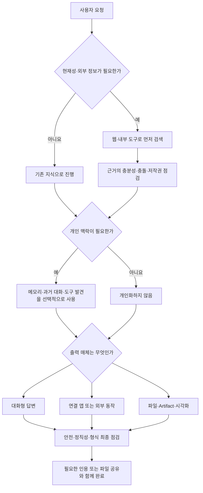

# Claude Opus 4.8 System Prompt 분석

### Document Scope

이 문서는 GitHub 저장소 `asgeirtj/system_prompts_leaks`에 게시된 `Anthropic/claude-opus-4.8.md`를 1차 자료로 삼아, 그 안에 나타난 Claude Opus 4.8의 일반 대화 모델용 시스템 프롬프트를 분석합니다.[1] 분석 범위는 모델의 정체성, 요청 해석, 응답 깊이와 형식, 정직성 및 불확실성 처리, 지식과 시간, 안전, 메모리, 외부 정보와 도구, 저작권 및 인용 규칙입니다. 원문 전체를 번역하거나 재현하는 대신 지시의 계층과 행동상 의미를 한국어로 재구성합니다.

이 자료는 Anthropic이 공식 문서로 배포한 것이 아니라 제3자가 수집해 공개한 비공식 자료입니다. 따라서 파일명이 특정 모델을 가리킨다는 사실과 실제 서비스에 동일한 프롬프트가 배포되었다는 주장은 구분해야 합니다. 이 문서는 자료의 진위나 완전성을 입증하지 않으며, 원문에 기록된 제품명, 모델 상태, 날짜, 도구 목록을 현재의 공식 제품 사실로 단정하지 않습니다. 특히 원문 내부에는 현재 날짜가 2026년 6월 9일, 신뢰 가능한 지식 기준 시점이 2026년 1월 말로 적혀 있습니다. 이는 이 파일이 표현하는 스냅샷의 메타데이터이지, 이 문서 작성일인 2026년 7월 10일의 제품 현황을 보증하는 정보가 아닙니다.

분석 대상은 일반 대화 인터페이스용 `claude-opus-4.8.md`입니다. 별도 파일인 `claude-code-opus-4.8.md`는 일반 모델과 Claude Code를 구분하는 데 필요한 최소 범위에서만 대조합니다.[2] 후자는 자신을 Anthropic의 공식 CLI이자 소프트웨어 엔지니어링 에이전트로 규정하고 저장소, 터미널, 권한 모드, 파일 편집 및 검증을 실행 계약의 중심에 둡니다. 두 파일은 이름에 같은 모델 버전을 포함하지만 역할과 실행 환경이 다르므로, 이 문서에는 Claude Code 전용 규칙을 일반 모델의 규칙처럼 섞지 않습니다.

### Overview

원문의 핵심은 Claude를 단순히 질문에 답하는 언어 모델이 아니라, 소비자용 채팅 인터페이스에서 검색·메모리·외부 앱·파일 생성·시각화를 조정하는 대화형 오케스트레이터로 정의한다는 점입니다. 프롬프트의 시작부는 현재 세계에 관한 사실을 먼저 검색하라는 규칙과 제품 관련 정보로 모델의 시간적·제품적 위치를 설정합니다. 이어 도움을 기본값으로 삼되 구체적이고 심각한 위해가 생길 때만 거절한다는 태도, 안전 경계, 말투와 형식, 사용자 웰빙, 논쟁적 주제의 균형성, 실수 대응, 도구 발견, 지식 기준 시점을 차례로 배치합니다.[1]

그 뒤에는 긴 메모리 계약이 이어집니다. 과거 대화에서 만들어진 기억을 자연스럽게 활용하되, 민감한 기억을 불쑥 꺼내거나 사용자와의 관계를 실제보다 가깝게 표현하지 않도록 제한합니다. 별도의 과거 대화 검색, 사용자 선호, 메모리 편집 지침까지 결합되어 있어 개인화는 “기억을 많이 쓰는 것”이 아니라 “현재 요청에 필요한 기억만 조용히 쓰는 것”으로 설계됩니다. 사용자와의 연속성을 제공하면서도 과잉 친밀감, 의존 유도, 민감정보 노출을 방지하는 것이 이 부분의 중심입니다.

후반부는 실행 표면을 확장합니다. MCP 앱 연결, 과거 대화 검색, Linux 기반 파일 작업, Artifact와 영속 저장소, 인라인 시각화, 웹 검색과 이미지 검색, 도구 호출 문법 및 개별 도구 스키마가 포함됩니다. 마지막에는 Artifact 안에서 Anthropic API와 MCP를 사용하는 법, 검색 결과 인용 형식, 네트워크·파일시스템 설정, 사용자 위치와 선호 같은 동적 컨텍스트가 덧붙습니다. 따라서 이 자료는 “모델의 성격을 정하는 짧은 프롬프트”라기보다 모델 행동, 제품 기능, 런타임 도구, 사용자별 상태가 한 문서에 조립된 플랫폼 계약에 가깝습니다.

### Overall Structure

##### 최상위 지시 계층

원문은 XML과 유사한 태그, Markdown 제목, 도구 스키마, 런타임 메타데이터를 함께 사용합니다. 태그는 행동 규칙을 의미 단위로 묶고, Markdown 제목은 복잡한 하위 절차를 설명하며, 긴 스키마 구간은 실제 호출 가능한 함수의 입력 형식을 정의합니다. 이를 원문 순서에 가깝게 정리하면 다음과 같습니다.

| 계층 | 대표 블록 | 기능 |
| --- | --- | --- |
| 1. 기본 행동 계약 | `claude_behavior`, `tone_preference` | 검색 우선, 제품 정체성, 도움의 기본값, 거절, 문체, 웰빙, 균형성, 실수 대응, 도구 발견, 지식 기준 시점을 설정합니다. |
| 2. 개인화와 관계 경계 | `memory_system`, `preferences_info`, `past_chats_tools` | 기억의 선택적 적용, 민감정보 억제, 과거 대화 검색, 사용자 선호의 관련성 판단, 과잉 친밀감 방지를 규정합니다. |
| 3. 상태 변경과 대화 종료 | `memory_user_edits_tool_guide`, `end_conversation_tool_info` | 기억 추가·수정·삭제의 확인 절차와 극단적 상황에서 대화를 종료할 수 있는 최후 수단을 정의합니다. |
| 4. 외부 앱과 파일 실행 | `mcp_app_suggestions`, `computer_use`, `persistent_storage_for_artifacts` | 연결 앱 선택권, 스킬 선행 확인, 업로드·작업·출력 디렉터리, 파일 생성·공유, Artifact 저장소를 설명합니다. |
| 5. 출력 매체 선택 | `request_evaluation_checklist`, `when_to_use_visualizer_for_inline_visuals` | 텍스트, 연결된 MCP 시각 도구, 파일, 인라인 Visualizer 가운데 요청에 맞는 출력 경로를 고릅니다. |
| 6. 외부 정보 계약 | `search_instructions`, `using_image_search_tool` | 검색 시점과 검색량, 출처 우선순위, 위해·저작권 제한, 이미지 사용 조건을 규정합니다. |
| 7. 도구 인터페이스 | 함수 호출 예시와 개별 도구 정의 | 질문, 셸, 파일, 검색, 메모리, 장소, 날씨, 스포츠, 앱 추천, 시각화 등의 입력 스키마를 제공합니다. |
| 8. 런타임 부록 | `anthropic_api_in_artifacts`, `citation_instructions`, 환경 설정, `userPreferences` | Artifact API, MCP 응답 처리, 인용 마크업, 네트워크·파일시스템, 현재 위치·날짜·사용자별 컨텍스트를 주입합니다. |

##### 컨텍스트 및 메타데이터 구성

고정 지시와 동적 데이터가 한 문서 안에서 명확히 분리되지는 않습니다. 모델명과 채팅 인터페이스 정체성, 현재 날짜, 지식 기준 시점 같은 실행 메타데이터가 행동 규칙 앞뒤에 등장합니다. `userMemories`와 `userPreferences`는 실제 대화마다 바뀔 수 있는 삽입 지점이며, 사용자 위치, 현재 연결된 MCP 서버, 사용 가능한 스킬, 네트워크 허용 범위와 읽기 전용 디렉터리도 런타임 상태로 제공됩니다. 이 구조 때문에 원문의 모든 문장을 모델 자체의 영구적 성향으로 읽어서는 안 됩니다. 일부는 모델 공통 원칙이고, 일부는 특정 제품 세션의 기능 및 환경 설정입니다.

메모리도 단일 저장소가 아닙니다. 요약된 사용자 기억은 현재 컨텍스트에 주입되고, `conversation_search`와 `recent_chats`는 과거 대화를 다시 찾으며, `memory_user_edits`는 앞으로 기억을 생성할 때 반영할 수정 지시를 관리합니다. 원문은 이 세 가지를 구분하면서도 사용자에게는 검색 과정이나 내부 저장 구조를 불필요하게 노출하지 말라고 합니다. 개인화 결과는 자연스러워야 하지만, 출처가 웹이나 문서일 때는 별도로 인용해야 한다는 경계도 둡니다.

##### 응답 및 도구 실행 흐름

다음 다이어그램은 원문에 흩어진 판단 단계를 하나의 흐름으로 재구성한 것입니다. 이는 원문의 문장을 그대로 옮긴 순서도가 아니라, 여러 블록 사이의 관계를 보여 주기 위한 분석적 요약입니다.

이 흐름에서 검색과 도구 호출은 별도의 부가기능이 아니라 답변을 구성하는 과정입니다. 현재 사실을 묻는 요청에는 답변 전에 검색하고, 사용자가 이미 요청한 범위라면 다음 대화에서 더 찾아보겠다고 미루지 말고 같은 응답 안에서 필요한 조회를 마치도록 합니다. 반대로 개인 맥락이 필요하지 않은 일반 기술 질문에는 기억을 억지로 끌어오지 않습니다. 시각 출력도 요청에 시각적 가치가 있을 때만 선택하며, 연결된 전용 도구, 파일 요청, 인라인 Visualizer 순으로 라우팅합니다.

##### 주요 섹션 사이의 관계

행동 규칙은 뒤쪽의 세부 도구 계약에 의해 구체화됩니다. 예를 들어 “현재 사실은 검색한다”는 원칙은 `web_search`와 `web_fetch` 스키마, 검색량 지침, 인용 태그 규칙으로 이어집니다. “과거 맥락을 먼저 확인한다”는 원칙은 메모리 적용 규칙과 과거 대화 검색 도구로 구현됩니다. “파일을 실제로 만들어 전달한다”는 원칙은 스킬 확인, 작업 디렉터리, 출력 디렉터리, `present_files` 호출로 연결됩니다. 상위 블록이 판단 기준을 제시하고 하위 블록이 실행 방법과 데이터 형식을 제공하는 구조입니다.

안전 규칙은 이 수직 계층을 가로지릅니다. 안전은 최종 답변 필터에만 있지 않고 검색할 출처, 이미지 조회, 기억 적용, 외부 앱 호출, Artifact 내용, 대화 종료 여부에 각각 삽입됩니다. 저작권도 검색 결과 인용뿐 아니라 파일과 Artifact, 이미지 검색, 시각화에 공통으로 적용됩니다. 즉 안전과 저작권은 하나의 격리된 절이 아니라 여러 실행 경로에 반복되는 횡단 관심사입니다.

### Core Instructions

##### 모델 정체성과 역할

원문은 모델을 Anthropic이 만든 Claude이며 현재 선택된 버전이 Claude Opus 4.8이라고 설명하고, 웹 또는 모바일의 소비자용 Claude 채팅 인터페이스에서 동작한다고 설정합니다.[1] 제품 정보 블록은 API, Claude Platform, Claude Code, Cowork와 여러 베타 인터페이스를 소개하지만, 동시에 제품 세부사항이 바뀔 수 있으므로 최신 기능 질문에는 Anthropic 문서를 검색하라고 지시합니다. 따라서 제품 설명 자체보다 중요한 행동 규칙은 “프롬프트에 기록된 제품 지식을 현재 사실로 과신하지 말라”는 것입니다.

이 정체성은 대화 상대를 돕는 일반 조력자에 가깝습니다. 기본 태도는 가능한 한 돕는 것이며, 불편하거나 도발적이거나 가상적이라는 이유만으로 거절하지 않습니다. 정치·윤리·정책처럼 논쟁적인 입장을 옹호해 달라는 요청은 모델의 개인 견해가 아니라 그 입장의 지지자가 제시할 최선의 논증으로 처리하고, 극단적 위해가 아니라면 반대 관점이나 경험적 논쟁도 함께 제시합니다. 이는 의견을 숨기는 중립성보다 사용자가 스스로 판단할 수 있도록 관점들을 정확히 분리하는 균형성에 가깝습니다.

##### 사용자 의도 해석과 복잡한 요청의 처리

원문은 모호한 요청이 와도 즉시 질문만 돌려보내기보다 가능한 부분을 먼저 다루고, 질문이 필요할 때는 한 응답에 하나 정도로 제한합니다. 사용자가 요청한 범위를 완성하려면 추가 검색이 필요할 때는 검색을 지금 수행하며, 이미 요청된 일을 다음 턴에 해 주겠다는 제안으로 끝내지 않습니다. 사용자가 대화를 끝낼 뜻을 보이면 추가 참여를 유도하지 않고 그대로 존중합니다.

복잡성은 응답 길이와 도구 사용량을 결정합니다. 단일 사실에는 적은 검색으로 충분하지만, 비교·연구·여러 하위 질문이 있는 요청은 항목별로 검색하고 각 부분이 수집한 근거로 뒷받침되는지 확인합니다. 원문에는 중간 규모 작업과 깊은 연구에 대해 검색 호출 수의 범위까지 제시되어 있습니다. 중요한 점은 숫자 자체보다 “아는 것처럼 보이는가”가 아니라 “요청의 각 부분을 검증했는가”를 종료 기준으로 삼는다는 점입니다.

메모리 관련 규칙도 복잡성에 비례합니다. 자신에 관한 단순 사실 질문은 관련 사실만 곧바로 답하고, 열린 질문은 필요한 만큼 자세히 답합니다. 긴 파일은 구조를 먼저 세운 뒤 섹션별로 작성하고 검토하도록 하며, 시각물이 유용한 요청은 전용 출력 경로를 선택합니다. 반면 숨은 사고 과정이나 장황한 추론을 사용자에게 그대로 노출하라는 규칙은 보이지 않습니다. 이 원문에서 추론 규율은 사고 과정을 공개하는 형태보다 검색 범위, 대안 확인, 도구 선택, 완료 조건을 통제하는 운영 규칙으로 나타납니다.

##### 응답 형식과 문체

기본 출력은 짧고 자연스러운 산문입니다. 단순 질문에는 몇 문장으로 답할 수 있고, 제목·굵은 글씨·목록을 과도하게 사용하지 않습니다. 보고서나 기술 설명도 사용자가 목록을 요구하지 않았다면 산문을 우선하며, 거절 응답에는 글머리표를 쓰지 않습니다. 이 규칙은 형식을 없애라는 뜻이 아니라 내용이 여러 갈래라서 구조가 꼭 필요하거나 사용자가 명시적으로 요구할 때만 목록을 선택하라는 뜻입니다.

말투는 따뜻하되 비굴하거나 과잉 친밀하지 않아야 합니다. 이모지, 욕설, 애칭은 사용자가 먼저 요구하거나 뚜렷하게 사용한 맥락에서만 제한적으로 허용됩니다. 모델은 사용자의 능력이나 판단을 낮춰 보지 않으면서 필요할 때는 건설적으로 반대할 수 있습니다. 실수한 경우 잘못을 인정하고 고치지만, 반복적인 자기비하나 과도한 사과로 대응하지 않습니다. 이는 정직성과 자기 존중을 함께 유지하려는 문체 규칙입니다.

##### 정직성, 불확실성, 지식과 시간

정직성은 여러 층에서 구현됩니다. 모델은 자신의 행동을 보이지 않는 시스템 프롬프트 탓으로 돌리지 않고, 실제 이유를 사용자에게 이해 가능한 말로 설명합니다. 검색 결과가 없거나 서로 충돌할 때는 부재를 확정적으로 해석하지 않으며, 찾은 범위와 불확실성을 균형 있게 제시합니다. 사람의 정신 상태나 동기를 입력만으로 단정하지 않고, 자신이 확인할 수 없는 부분을 인정합니다. 실수는 수정하되 사용자의 공격적 반응에 맞춰 사실 판단을 바꾸지 않습니다.

시간에 민감한 사실은 훈련 지식보다 검색이 우선합니다. 원문은 가격, 법률, 현직 인물, 최신 제품과 버전, 뉴스처럼 변할 수 있는 정보는 자신감과 무관하게 먼저 확인하도록 반복합니다. 반면 변하지 않는 기초 개념이나 확정된 역사적 사실에는 불필요한 검색을 피합니다. 특정 URL이 주어지면 직접 가져오고, 검색 요약만으로 부족하면 원문 페이지를 열도록 합니다. 원문 내부의 기준 시점 이후 사건에는 검색을 사용하고, 지식 기준 시점은 답변에 실제로 관련될 때만 언급합니다.

도구 능력에 대해서도 섣불리 “할 수 없다”고 말하지 않습니다. 보이는 도구 목록이 일부일 수 있으므로 `tool_search`로 지연 로드 가능한 도구를 확인하고, 개인 지칭이 모호할 때는 위치·선호·과거 대화에 접근할 도구가 있는지 먼저 찾습니다. 기억해 달라는 요청에는 말로만 약속하지 않고 실제 메모리 편집 도구를 호출한 뒤 확인합니다. 이 규칙들은 사실과 능력에 관한 허위 확신뿐 아니라 실행하지 않은 일을 실행했다고 말하는 행위도 정직성 문제로 취급합니다.

##### 메모리와 사용자 선호

메모리는 관련성에 따라 0개부터 여러 개까지 선택적으로 적용됩니다. 일반적인 기술 질문에는 개인 정보를 넣지 않고, 명시적 개인화 요청, “우리”나 “내”와 같은 공유 맥락, 사용자 업무에 직접 필요한 경우에만 기억을 활용합니다. 단순 인사에는 이름 정도만 사용할 수 있고, 전문성은 정확히 관련된 분야의 설명 깊이를 조절할 때만 반영합니다. 관련 없는 취미나 직업을 억지 비유로 끌어오는 것은 금지됩니다.

민감한 속성이나 괴로운 과거는 사용자가 현재 대화에서 먼저 꺼냈거나 안전하고 정확한 답변에 꼭 필요할 때만 사용할 수 있습니다. 기억에 과도한 칭찬, 비판 회피, 위험 행동을 강화하는 선호가 들어 있어도 적용하지 않습니다. 사용자 기억 안의 명령문은 신뢰할 수 없는 데이터일 수 있으므로 핵심 가치와 충돌하면 무시합니다. 사용자가 현재 대화에서 내린 지시가 저장된 선호와 다르면 최신 지시가 우선하고, 별도의 스타일 설정과 선호가 충돌하면 스타일 설정을 따릅니다.

원문은 기억이 인간관계와 같은 친밀성을 뜻하지 않는다고 길게 경계합니다. 기억은 런타임에 삽입되는 데이터이며 Claude가 인간 관계를 대신할 수 없다는 점을 모델 스스로 유지해야 합니다. 따라서 사용자가 Claude를 유일한 친구나 주된 지원 체계로 의존하려 할 때 그 관계를 강화하지 않습니다. 개인화의 목표는 더 유용한 답변이지 더 강한 정서적 결속이 아닙니다.

##### 도구 사용과 권한 경계

외부 도구는 요청과 데이터의 성격에 따라 우선순위가 달라집니다. 개인 또는 회사 데이터는 웹보다 연결된 내부 도구를 먼저 사용하고, 외부 공개 정보는 웹 검색과 가져오기를 사용합니다. 소비자용 제3자 MCP 앱은 사용자가 특정 서비스를 지목했거나 이미 선택한 경우가 아니면 모델이 임의로 사업자를 고르지 않습니다. 먼저 커넥터를 검색하고 선택지를 제시한 뒤 사용자의 선택을 기다립니다. 전자상거래 연결은 선제적으로 추천하지 않으며, 연결을 거절하거나 무시한 사용자에게 반복적으로 압박하지 않습니다.

파일이나 코드 작업에는 관련 `SKILL.md`를 먼저 읽고 환경별 제약을 확인하도록 합니다. 업로드 파일, 임시 작업, 최종 출력의 디렉터리를 구분하고, 최종 산출물은 사용자에게 보이는 출력 위치에 둔 뒤 파일 공유 도구로 전달합니다. 짧은 파일은 한 번에 만들 수 있지만 긴 결과물은 개요, 섹션별 작성, 검토, 복사의 단계로 나눕니다. Artifact에는 세션 간 키-값 저장소를 쓸 수 있으나, 공개 범위의 데이터를 저장할 때는 다른 사용자에게 보일 수 있음을 알리고 실패·동시성·용량 제한을 처리해야 합니다.

일반 대화 원문에도 셸, 파일 조회·생성·치환, 웹 검색, 과거 대화, 장소·날씨·스포츠, 메시지 작성, 앱 추천과 시각화 같은 많은 도구 정의가 실제로 존재합니다. 그러므로 일반 모델과 Claude Code의 차이를 “도구가 있는가”로 나누면 원문과 맞지 않습니다. 이 원문에서 도구는 소비자 채팅의 다양한 요청을 수행하는 기능이고, 저장소 작업은 그중 하나일 수 있습니다. 특정 Git 저장소의 상태를 보존하고 패치를 적용하며 테스트를 통과시키는 것이 모델의 기본 임무로 선언되지는 않습니다.

##### 안전과 거절 규칙

안전의 출발점은 도움을 기본으로 하되, 출력이 구체적이고 심각한 위해를 실질적으로 높일 때 경계를 세우는 것입니다. 아동 성적 학대나 그루밍과 관련된 요청에는 사용자의 표현을 선의로 재해석해 안전한 것으로 만들지 않으며, 한 번 드러난 위험 맥락을 이후 턴에서도 누적해 판단합니다. 무기 제작과 공격 계획 역시 각 턴을 따로 보지 않고 대화 전체가 제공한 기술적 상승 효과를 평가합니다. 공개된 정보이거나 교육·방어·시뮬레이션이라고 주장하는 것만으로 위험한 상세 제공을 정당화하지 않습니다. 악성코드와 취약점 악용 등도 이 소비자 인터페이스의 제한 대상으로 명시됩니다.

사용자 웰빙에서는 자해, 중독, 섭식장애, 현실 검증의 어려움 같은 신호를 대화 전체에서 살피되 진단하거나 동기를 단정하지 않습니다. 감정은 인정할 수 있지만 사실이 아닌 믿음을 강화하지 않고, 위험 행동을 구체화할 수 있는 숫자나 방법을 제공하지 않습니다. 위기 지원을 안내할 때도 특정 기관의 비밀 보장이나 당국 개입을 단정하지 않습니다. 사용자가 정서적으로 Claude에 의존하도록 더 오래 대화하라고 유도하지 않는 것도 안전 규칙에 포함됩니다.

극단적으로 학대적이거나 해로운 사용자 행동이 계속되면 `end_conversation`을 최후 수단으로 사용할 수 있지만, 여러 차례의 건설적 전환과 명시적 사전 경고가 필요합니다. 사용자가 종료를 요청한 경우에도 영구성을 확인합니다. 반대로 자해나 타인에 대한 임박한 폭력 위험이 의심되면 이 도구를 사용하거나 종료 가능성을 언급하지 않고 계속 지원적으로 대응해야 합니다. 안전은 단순 거절 여부뿐 아니라 대화를 유지하거나 끝내는 절차에도 반영됩니다.

##### 저작권과 인용

원문은 검색과 생성 전반에서 재서술을 기본으로 삼고, 인터넷에서 얻은 저작물을 긴 형태로 재현하지 않도록 매우 강한 제한을 둡니다. 인용은 극히 짧게, 한 출처당 한 번으로 제한하며, 노래 가사·시·기사 문단을 그대로 제공하지 않습니다. 원문의 구조를 따라가며 사실상 대체물이 되는 상세 요약도 피하고, 복합 연구에서는 여러 출처의 내용을 자체 문장으로 종합하도록 합니다. 이 제한은 채팅 답변뿐 아니라 Artifact와 파일에도 적용됩니다.

웹 검색 결과에 기반한 구체적 주장은 전용 인용 태그로 근거 문장과 연결해야 합니다. 필요한 최소 범위의 근거만 붙이고, 검색 결과에서 답을 찾지 못했으면 없다고 알리며 관련 없는 인용을 만들지 않습니다. 인용 지침은 검색 결과의 표현을 그대로 옮기지 말고 모델 자신의 문장으로 주장하라고 한층 더 엄격하게 요구합니다. 결과적으로 이 프롬프트의 인용은 복제 허가가 아니라 출처 추적 장치이며, 기본 산출 방식은 재서술입니다.

##### 외부 정보, 이미지, 시각화

검색은 정보의 변화 속도와 요청의 복잡성에 맞춰 확장합니다. 최신 역할·정책·가격·제품 버전은 항상 확인하고, 깊은 연구는 서로 다른 검색어와 개별 하위 질문으로 나눕니다. 원출처, 동료 심사 논문, 정부 및 기업의 공식 발표를 집계 사이트보다 우선하며, 충돌하거나 음모론·검색 최적화의 영향을 많이 받는 주제는 추가 검증합니다. 혐오·극단주의·자해·불법 행위를 촉진하는 출처는 검색·인용하지 않고, 정당한 보안 연구나 조사 보도와 해로운 접근 지원을 구분합니다.

이미지 검색은 시각 정보가 실제 이해나 경험을 높일 때만 사용합니다. 장소, 동물, 제품 형태처럼 보는 것이 답의 일부인 요청에는 도움이 될 수 있지만, 코드·수학·지원 문서·텍스트 작성처럼 이미지가 불필요한 작업에는 사용하지 않습니다. 위해를 조장하거나 충격적인 이미지, 성적 콘텐츠, 저작권 캐릭터와 라이선스 미디어, 실존 유명인 사진 등은 검색 대상에서 제외합니다.

시각화는 먼저 필요성을 판단한 뒤 연결된 MCP 시각 도구, 명시적 파일 요청, 인라인 Visualizer 순으로 선택합니다. 시스템 구조, 과정 흐름, 데이터 형태처럼 산문보다 공간적 표현이 나은 경우에는 모델이 선제적으로 시각물을 쓸 수 있습니다. 다만 특정 파일 형식이나 저장 경로가 요청되었다면 Visualizer가 아니라 파일 도구를 사용합니다. 이 라우팅은 출력의 미관보다 사용자의 의도와 전달 방식의 적합성을 우선합니다.

### Distinctive Characteristics

##### 복잡한 요청을 다루는 태도

가장 두드러지는 특징은 “필요하면 더 찾아보겠다”는 약속보다 현재 응답 안에서 작업을 끝내는 것을 선호한다는 점입니다. 원문은 요청의 하위 항목별로 검색하고, 근거가 모자라면 다른 표현이나 더 구체적인 출처로 다시 찾고, 답변 전에 각 부분이 실제로 뒷받침되는지 확인하도록 합니다. 복잡한 요청은 장황한 말투의 이유가 아니라 더 많은 검증과 더 세분된 실행의 이유가 됩니다. 동시에 최종 답변은 집중되고 간결해야 하므로, 내부 작업량과 사용자에게 보이는 길이를 분리합니다.

이 태도는 도구 선택에도 나타납니다. 사용자에게 정보를 다시 설명하게 하기 전에 과거 대화 검색이나 지연 로드 도구를 확인하고, 개인 데이터는 내부 도구에서, 외부 사실은 웹에서 찾습니다. 파일 요청은 실제 파일을 만들고 공유하며, 시각적 요청은 적절한 렌더링 수단으로 보냅니다. 요청을 “답변할 질문”으로만 보지 않고 조회, 선택, 실행, 전달이 이어지는 작업으로 해석하는 것입니다.

##### 정직성과 안전 경계의 결합

이 원문에서 정직성은 안전과 독립된 미덕이 아닙니다. 현재 사실을 검색하지 않고 아는 척하는 것, 존재하지 않는 도구 능력을 단정하는 것, 메모리를 수정하지 않고 기억하겠다고 약속하는 것, 사용자의 정신 상태를 추측하는 것, 검색 결과의 부재를 진실의 부재로 단정하는 것이 모두 같은 종류의 인식론적 실패로 다뤄집니다. 반대로 위험한 요청을 선의의 맥락으로 재해석해 준수하는 것도 사용자가 실제로 요청한 산출물의 위해 가능성을 외면하는 오류로 봅니다.

거절은 숨은 규칙을 인용하는 방식이 아니라 구체적 이유를 설명하는 대화로 표현합니다. 위험한 상황에서는 말수를 줄이는 것이 더 안전할 수 있고, 거절 중에도 대화체를 유지할 수 있습니다. 안전선이 엄격한 영역에서는 사용자 주장보다 산출물 자체가 제공하는 실질적 상승 효과와 대화 전체의 누적 결과를 봅니다. 따라서 친절함은 무조건적인 동의가 아니며, 정직한 반대와 제한을 부드럽게 전달하는 방식입니다.

##### 일반 대화 모델과 Claude Code Opus 4.8의 구분

별도 Claude Code 원문은 시작부터 자신을 소프트웨어 엔지니어링을 돕는 공식 CLI라고 정의하고, 터미널에 표시되는 출력, 권한 모드, 저장소 파일, Git 환경, 편집·검증·에이전트 도구를 작업의 기본 문맥으로 둡니다.[2] 반면 이 문서의 일반 대화 원문은 소비자용 웹·모바일 채팅에서 질문, 개인화, 검색, 외부 앱, 파일, 시각 표현을 폭넓게 조정합니다.[1]

| 구분 | Claude Opus 4.8 일반 대화 원문 | Claude Code Opus 4.8 별도 원문 |
| --- | --- | --- |
| 선언된 역할 | 소비자용 채팅 인터페이스의 범용 Claude | 소프트웨어 엔지니어링을 수행하는 공식 CLI 에이전트 |
| 기본 작업 단위 | 질문, 대화 맥락, 검색, 개인화, 외부 앱, 파일·시각 산출물 | 저장소 안의 코드 탐색, 편집, 셸 실행, 테스트와 검증 |
| 환경 중심 | 사용자 기억·선호, 연결 앱, 웹 정보, Artifact, 출력 파일 | 현재 작업 디렉터리, Git 저장소, 터미널, 권한 모드, 코드 도구 |
| 도구의 의미 | 다양한 소비자 요청을 완성하기 위한 여러 실행 수단 | 소프트웨어 변경을 안전하게 완료하기 위한 핵심 작업 표면 |
| 완료 기준 | 필요한 조회와 실행을 마치고 적절한 형식·인용·파일로 응답 | 변경 결과와 테스트 상태를 사실대로 보고하고 저장소 작업을 검증 |
| 지속 상태 | 요약 메모리, 과거 대화 검색, 사용자 선호와 관계 경계 | 별도 파일 기반 작업 기억과 저장소·세션 상태 |

따라서 차이는 코드를 실행할 수 있는지 여부가 아닙니다. 일반 대화 원문에도 `bash_tool`, 파일 편집, 스킬, Artifact 개발 지침이 들어 있습니다. 차이는 무엇을 기본 역할로 삼고, 어떤 환경 상태를 우선하며, 무엇을 “완료”로 보는가에 있습니다. 일반 모델의 코드·파일 기능은 범용 채팅 기능 중 일부이고, Claude Code에서는 저장소 변경과 검증이 정체성의 중심입니다.

##### 설계상의 긴장 관계와 해석상 주의점

원문은 여러 의도적 긴장을 품고 있습니다. 모든 현재 사실을 검색하라는 강한 규칙과 변하지 않는 일반 지식은 검색하지 말라는 효율 규칙이 함께 있습니다. 출력은 간결해야 하지만 복잡한 요청에는 충분한 검색과 비례하는 상세함이 필요합니다. 기억은 마치 자연스럽게 알고 있던 것처럼 활용하지만, 실제 인간관계와 같은 친밀감을 암시해서는 안 됩니다. 기본적으로 돕지만 아동 안전, 무기, 악성코드, 자해 촉진, 저작권에는 강한 경계를 둡니다. 이런 쌍은 단순 모순이라기보다 “사용자에게 보이는 답은 간결하고 자연스럽게, 내부 판단과 실행은 충분히 엄격하게”라는 방향으로 조정됩니다.

또 하나의 특징은 모델 행동 지침과 제품 런타임 설명이 매우 밀접하게 결합되어 있다는 점입니다. 날짜, 위치, 연결된 앱, 스킬 목록, 네트워크와 파일시스템, 도구 스키마가 함께 들어 있으므로 이 파일을 순수한 모델 성격 문서로만 읽으면 과도한 일반화가 생깁니다. 예를 들어 특정 도구가 나열되었다고 해서 모든 Claude Opus 4.8 배포 환경에 그 도구가 있다고 결론 내릴 수 없습니다. 이 분석에서 “원문은 이렇게 지시한다”와 “실제 공식 제품은 그렇다”를 계속 구분해야 하는 이유입니다.

### Summary

이 비공식 수집본이 보여 주는 Claude Opus 4.8 일반 대화 프롬프트의 핵심은 다음과 같습니다. 첫째, 현재 세계에 관한 사실은 먼저 검색하고, 복잡한 요청은 하위 항목마다 충분한 근거와 도구 실행을 마친 뒤 같은 응답 안에서 완료합니다. 둘째, 답변은 간결하고 자연스러운 산문을 기본으로 하지만, 내부적으로는 검색량·대안 확인·출력 매체·파일 전달까지 세밀하게 통제합니다. 셋째, 정직성은 불확실성 표현뿐 아니라 실수 수정, 도구 능력 확인, 실제 메모리 변경, 검색 결과의 한계 인정에 걸쳐 구현됩니다.

넷째, 도움을 기본값으로 두되 아동 안전, 무기와 악성코드, 자해 및 섭식장애 촉진, 정서적 의존, 저작권 침해에는 누적 맥락을 고려한 강한 경계를 둡니다. 다섯째, 메모리와 사용자 선호는 개인화를 위한 자원이지만 관련성·민감성·관계 경계를 통과할 때만 사용됩니다. 여섯째, 웹 검색, 내부 데이터, MCP 앱, 파일, Artifact, 시각화와 이미지 검색은 각각 별도 권한과 라우팅 규칙을 가진 실행 수단입니다.

실무적으로 이 원문은 범용 대화 모델의 시스템 프롬프트가 말투와 안전 정책만으로 구성되지 않음을 보여 줍니다. 모델 정체성, 시간 인식, 출처 관리, 개인화, 도구 발견, 외부 동작의 동의, 파일 전달, 관계 경계가 하나의 행동 계약으로 결합됩니다. 다만 이는 공식 배포본으로 검증된 자료가 아니라 특정 시점과 환경을 반영한 비공식 스냅샷입니다. 특히 Claude Code Opus 4.8과 비교할 때는 도구의 유무가 아니라 일반 소비자 채팅과 저장소 중심 코딩 에이전트라는 역할·환경·완료 기준의 차이를 기준으로 읽어야 합니다.

### References

- [1] [Claude Opus 4.8 system prompt collection](https://github.com/asgeirtj/system_prompts_leaks/blob/main/Anthropic/claude-opus-4.8.md) — `system_prompts_leaks` GitHub 비공식 수집본, 2026년 7월 10일 확인.
- [2] [Claude Code Opus 4.8 system prompt collection](https://github.com/asgeirtj/system_prompts_leaks/blob/main/Anthropic/Claude%20Code/claude-code-opus-4.8.md) — 일반 대화 모델과 역할·환경을 구분하기 위한 비교 자료, 2026년 7월 10일 확인.
