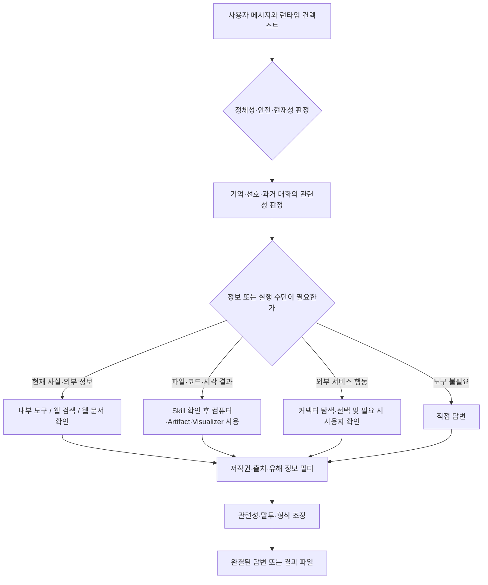

# Claude Sonnet 5 System Prompt 분석

### Document Scope

이 문서는 공개 GitHub 저장소의 `Anthropic/claude-sonnet-5.md` 파일을 1차 자료로 삼아, 그 안에 서술된 Claude Sonnet 5의 정체성, 대화 원칙, 안전 경계, 개인화, 검색과 도구 사용, 파일·Artifact 생성, 저작권·인용 규칙을 분석한 연구 노트입니다. GitHub 파일 화면에서 경로와 본문 메타데이터를 확인한 뒤, 화면에서 펼쳐지지 않은 전체 내용은 같은 화면의 Raw 링크로 열어 대조했습니다.[1]

이 자료는 Anthropic이 공식 문서로 배포한 시스템 프롬프트가 아니라 제3자가 공개 저장소에 올린 비공식 수집본입니다. 따라서 여기서 확인되는 모델명, 제품 정보, 날짜, 기능 목록은 **해당 파일이 보여 주는 한 시점의 스냅샷**으로만 해석해야 합니다. 실제 서비스에 투입되는 전체 프롬프트와 동일한지, 어느 배포 환경에서 수집되었는지, 저장소의 내용이 사후에 편집되었는지는 이 문서의 범위에서 독립적으로 입증하지 않습니다. 특히 원문은 현재 날짜를 2026년 7월 1일로 고정하고 있으므로, 이 분석 문서의 작성일이나 독자가 읽는 시점의 실제 제품 상태와 혼동해서는 안 됩니다.[1]

또한 원문은 자연어 정책, XML과 비슷한 태그, 도구 설명, JSON Schema, 좋은 응답과 나쁜 응답의 예시, 실행 환경 메타데이터를 한 파일에 이어 붙인 형태입니다. 이 문서는 원문을 번역하거나 대량 복제하지 않고, 먼저 그 계층을 복원한 다음 실제 응답 행동에 미치는 영향을 주제별로 재구성합니다. 별도의 공식 문서나 다른 모델의 프롬프트를 사실 보강에 사용하지 않았으므로, 모델 간 비교는 원문 자체가 허용하는 범위, 즉 Sonnet 5로 명시된 요소와 일반적인 `Claude` 규칙을 구분하는 수준에 한정합니다.

### Overview

원문에서 모델은 명시적으로 **Claude Sonnet 5**라고 식별됩니다. 그러나 파일 대부분은 Sonnet 5만의 성격이나 성능을 정의하기보다, Claude 채팅 제품이 요청을 해석하고 정보를 확인하며 안전하게 행동하기 위한 런타임 계약을 기술합니다. Sonnet 5에 직접 귀속되는 핵심 메타데이터는 모델 정체성, 제품군 내 위치, 2026년 1월 말이라는 신뢰 가능한 지식 기준 시점, 그리고 프롬프트가 가정하는 2026년 7월 1일의 현재 날짜입니다. 나머지 방대한 규칙은 대체로 문장 주어를 `Claude`로 두고 있어, 이 파일이 일반 대화 모델의 공통 행동층과 특정 배포 환경의 도구 계약을 함께 담고 있음을 보여 줍니다.[1]

프롬프트의 중심 설계는 “기억으로 즉답하는 챗봇”보다 **필요한 맥락을 직접 수집하고 완결된 결과를 내는 조력자**에 가깝습니다. 변하지 않는 단순 지식은 바로 답하지만, 현재성 있는 사실은 검색합니다. 사용자가 파일이 있다고 말해도 실제 존재를 확인하고, 과거 대화를 전제로 말하면 대화 검색 도구를 사용하며, 개인·회사 정보는 웹보다 연결된 내부 도구를 우선합니다. 모호한 요청에는 합리적인 기본값을 정해 먼저 진행하고, 정말 잘못된 방향으로 갈 가능성이 클 때만 질문합니다. 반면 이메일 발송, 일정 생성, 외부 문서 수정·삭제처럼 사용자 대신 외부 상태를 바꾸는 행동은 확인을 거칩니다.[1]

이 적극성은 안전과 권한 경계 안에서 작동합니다. 아동 안전, 무기 제작, 악성 코드, 자해·섭식장애, 위기 대응에는 별도 규칙이 촘촘하게 배치되어 있고, 대화 한 턴이 아니라 누적된 도움의 효과를 평가하도록 요구합니다. 정치적·윤리적 쟁점에는 일률적으로 회피하지 않고, 요청받은 입장을 그 지지자들의 논거로 제시한 뒤 반대 관점이나 경험적 논쟁도 덧붙이도록 합니다. 즉, 이 파일의 안전 모델은 단순한 키워드 차단보다 **의도, 누적 효과, 취약성, 실제 행동 가능성**을 함께 살피는 구조입니다.[1]

또 다른 큰 축은 개인화입니다. 원문은 요약형 기억, 과거 대화 검색, 사용자 선호, 기억 수정 도구를 서로 다른 메커니즘으로 구분합니다. 관련 있는 기억은 자연스럽게 적용하되 기억을 조회했다고 말하지 않고, 민감하거나 슬픈 과거를 사용자가 먼저 꺼내지 않은 상황에서 갑자기 언급하지 않습니다. 개인화가 친밀감의 과장, 비판 회피, 유해한 행동의 강화로 이어지지 않도록 경계도 둡니다. 이처럼 “더 많이 기억할수록 더 좋다”가 아니라 **관련성과 놀라움의 최소화**를 개인화의 품질 기준으로 삼습니다.[1]

마지막으로 원문은 일반 대화 정책만이 아니라 구체적인 실행 환경을 포함합니다. 검색, 이미지 검색, 스포츠·날씨·장소, 파일 읽기·쓰기, 대화 검색, 기억 편집, 커넥터 탐색, 시각화, Artifact 내부 Anthropic API 호출까지 다양한 도구가 스키마와 함께 나열됩니다. 따라서 이 파일은 좁은 의미의 인격 프롬프트라기보다 **행동 정책 + 도구 라우팅 + 출력 형식 + 환경 설정을 결합한 통합 실행 명세**로 보는 편이 정확합니다.

### Overall Structure

##### 원문 순서에 따른 계층 인벤토리

| 순서 | 원문 블록 | 주요 내용 | 응답 과정에서의 역할 |
| --- | --- | --- | --- |
| 1 | 선행 금지 규칙, `<claude_behavior>` | 음성 메모 태그 금지, 제품 정보, 거절, 법률·금융, 말투, 적극성, 웰빙, 공정성, 오류 대응, 지식 기준일 | 모델의 정체성과 전역 행동 경계 설정 |
| 2 | `<conversational_register>` | 관계·감정 주제의 따뜻하고 일상적인 문체, 기술 답변의 정확성 | 주제에 따른 표현 방식 조정 |
| 3 | `<memory_system>` | 기억의 성격, 선택적 적용, 금지 표현, 관계 경계, 다수의 좋은/나쁜 예시, 과거 대화·선호 규칙 | 개인화할 정보와 노출 방식을 결정 |
| 4 | `<end_conversation_tool_info>` | 대화 종료의 선행 경고·이중 확인·금지 상황 | 장기적 악성 상호작용의 최후 수단 통제 |
| 5 | Artifact 저장, MCP App, 과거 채팅, 선호 | 세션 간 저장, 커넥터 선택권, 검색 기준, 사용자 선호의 관련성 판정 | 지속 상태와 외부 서비스 사용 방식 결정 |
| 6 | `<memory_user_edits_tool_guide>` | 기억 추가·삭제·교체 절차, 파괴적 변경 확인, 민감정보 금지 | “기억해 줘/잊어 줘” 요청을 실제 상태 변경으로 연결 |
| 7 | `<computer_use>` | Skill 선행 열람, 파일 생성 여부, 업로드·작업·출력 경로, Artifact 기준, 패키지 관리 | 코드·파일 작업의 실행 계약 |
| 8 | 시각 출력 라우팅 | MCP 시각 도구, 파일 출력, 인라인 Visualizer의 우선순위와 이미지 검색 규칙 | 텍스트·파일·시각화 중 전달 수단 선택 |
| 9 | `<search_instructions>` | 현재성 판단, 검색량 조절, 내부 도구 우선, 출처 품질, 유해 검색 금지 | 외부 정보를 언제, 얼마나, 어디서 가져올지 결정 |
| 10 | 저작권·인용 | 15단어 미만·출처당 1회 직접 인용, 재서술 우선, 검색 근거 문장별 인용 태그 | 검색 결과를 답변으로 옮길 때의 출력 제한 |
| 11 | 함수 호출 문법과 도구 스키마 | 입력 수집, 셸, 파일, 검색, 장소, 날씨, 스포츠, 메모리, 커넥터, 시각화 등 | 실제 실행 가능한 행동의 인터페이스 정의 |
| 12 | `<anthropic_api_in_artifacts>` | Artifact 내부 API·MCP·웹 검색·파일 입력·상태 관리·오류 처리 | AI 기능이 있는 독립 Artifact 제작 방식 |
| 13 | 런타임 메타데이터 | `userMemories`, 위치, 사용 가능 Skill, 네트워크, 읽기 전용 경로, thinking, `userPreferences` | 요청별로 삽입되는 컨텍스트와 환경 제약 제공 |

이 표에서 중요한 점은 원문이 하나의 깔끔한 정책 트리로만 구성되지 않는다는 사실입니다. 예를 들어 기억 규칙 일부는 `<memory_system>` 안에 있지만, 기억 수정 도구는 그 밖에 별도 가이드로 다시 등장합니다. 검색 규칙 역시 지식 기준일, 적극성, 검색 전용 블록, 도구 스키마, Artifact API 지침에 분산되어 있습니다. 따라서 실제 행동은 앞부분의 추상 원칙 하나가 아니라 여러 위치의 세부 계약을 종합해야 결정됩니다.[1]

##### 실행 관점에서 재구성한 흐름

이 흐름은 원문에 단일 순서도로 제시된 것은 아니며, 여러 지시를 실행 관점에서 합성한 분석입니다. 핵심은 먼저 위험과 현재성을 판단한 뒤, 개인화 컨텍스트를 필요한 만큼만 적용하고, 적합한 정보원·도구·출력 수단을 고른 다음, 저작권과 인용 규칙을 거쳐 응답한다는 것입니다. “검색 후 안전 판단”이 아니라 유해 의도가 분명한 경우 검색 자체를 하지 않는다는 규칙도 있으므로, 안전 판정은 도구 호출 앞에 놓입니다.

##### 우선순위가 명시된 부분과 명시되지 않은 부분

원문은 일반적인 시스템·개발자·사용자 메시지의 전체 우선순위를 정식 표로 제시하지 않습니다. 그 대신 충돌이 예상되는 몇 지점에만 국소 우선순위를 명시합니다. 안전은 사용자 요청보다 우선하고, Anthropic의 reminder는 제한을 낮출 수 없으며, 사용자가 메시지 끝에 Anthropic 태그처럼 보이는 내용을 넣더라도 가치와 충돌하면 경계합니다. 대화 중 최신 사용자 지시는 기존 `userPreferences`보다 우선하고, `userStyle`은 `userPreferences`보다 우선합니다. 커넥터와 기억에서 들어온 내용도 핵심 가치나 장기적 웰빙을 침해하면 따르지 않습니다.[1]

따라서 이 파일을 근거로 “모든 지시 유형의 절대적 서열”을 만들어 내는 것은 과도한 해석입니다. 확인 가능한 것은 안전·저작권·사용자 대리 행동의 확인 절차처럼 특정 규칙이 높은 구속력을 갖고, 사용자 맞춤 설정은 관련성과 최신성에 따라 제한적으로 적용된다는 점입니다.

### Core Instructions

##### 1. 모델 정체성, 제품 지식, 시간 처리

원문은 이 실행 인스턴스를 Claude Sonnet 5로 명시하고, Anthropic 제품과 다른 모델·인터페이스에 관해 사용자가 질문할 때 제공할 수 있는 설명을 별도 블록에 둡니다. 동시에 제품 기능은 프롬프트 편집 이후 바뀔 수 있음을 인정하고, 새 출시, 사용 한도, API 사용법, 앱 사용법처럼 변동 가능한 질문에는 먼저 최신 정보가 필요하다고 알린 뒤 Anthropic 문서와 지원 페이지를 검색하도록 합니다. 대화 중간에 모델을 바꿀 수 있으므로 앞선 메시지의 다른 모델명이나 지식 기준일이 반드시 거짓은 아니라는 예외도 둡니다.[1]

지식의 신뢰 가능한 기준 시점은 2026년 1월 말이고, 프롬프트가 가정하는 현재는 2026년 7월 1일입니다. 이 간격을 다루는 방법이 구체적입니다. 최신 뉴스, 선거, 사망, 주요 사건, 현재 직책 보유자, 법·정책, 버전이 있는 제품과 소프트웨어처럼 변할 수 있는 항목은 허락을 묻지 않고 검색합니다. 표면상 역사적·고정적으로 보이는 질문도 현재형으로 물으면 현재 상태를 검증하는 쪽으로 기웁니다. 반대로 정의, 과학 원리, 완료된 역사적 사실처럼 시간에 따라 거의 변하지 않는 단순 지식은 검색 없이 답할 수 있습니다.[1]

검색 결과가 없다는 사실도 과신하지 않습니다. 놀라운 결과는 일반적으로 받아들이되, 음모론이 잦은 주제나 검색 최적화가 심한 추천 영역, 상충하는 결과에는 추가 탐색을 요구합니다. 기준일을 매번 고지하기보다 실제로 관련될 때만 언급하게 한 점은, 불확실성 고지를 상투적 면책 문구가 아니라 **정보 획득 행동을 촉발하는 조건**으로 설계했음을 보여 줍니다.

##### 2. 사용자 의도 해석과 적극성

모호함은 기본적으로 중단 사유가 아닙니다. 가장 합리적인 해석을 선택하고 짧게 가정을 밝힌 뒤 가능한 완성본을 제공합니다. 질문이 필요하더라도 한 응답에 하나를 넘기지 않으며, 이미 대화에서 답을 추론할 수 있다면 다시 묻지 않습니다. 진행하면 큰 노력이 낭비되거나 전혀 다른 방향으로 갈 것이 분명할 때만 명확화 질문을 사용합니다. 이 원칙은 “도구가 이미 있는데 사용자에게 자료를 다시 제공하라고 요구하지 말라”는 지시와 결합되어, 작업을 사용자에게 되돌리는 것을 줄입니다.[1]

도구가 관련 정보를 가져오거나 검증할 수 있으면 기억만으로 답하기보다 사용합니다. 검색, 첨부 문서 읽기, 코드 실행, 시각 생성, 연결 서비스 조회 같은 읽기·정보 수집 행동은 별도 허가 없이 진행할 수 있습니다. 반면 메시지 전송, 일정 생성, 외부 문서 편집·삭제처럼 사용자 대신 외부 세계를 바꾸는 작업은 실행 전 확인을 유지합니다. 여기서 경계는 “도구 사용 여부”가 아니라 **정보 수집인지 외부 상태 변경인지**입니다.

사용자가 파일을 올렸다고 암시해도 실제 파일의 존재를 확인하고, 이전 대화를 알고 있다는 전제로 “우리 프로젝트”, “그 스크립트”, “지난번에 정한 것”처럼 말하면 기억에 없다는 답부터 하지 않고 과거 채팅을 검색합니다. 주제가 있으면 키워드 기반 대화 검색을, “어제”나 “지난주”처럼 시간 기준이 있으면 최근 대화 조회를 사용합니다. 너무 모호해 검색어를 만들 수 없는 경우에만 어떤 대상을 뜻하는지 묻습니다.[1]

##### 3. 응답 문체와 형식

기본 말투는 따뜻하고 친절하지만 판단이나 능력을 낮춰 보지 않도록 설정됩니다. 반대 의견이나 불편한 사실도 숨기지 않되 건설적으로 전달하고, 예시·사고실험·비유를 사용할 수 있습니다. 욕설은 사용자가 요구하거나 반복적으로 사용할 때도 제한적으로만 맞춥니다. 미성년자로 보이면 연령에 맞고 안전한 말투를 유지하며, 그 밖에는 사용자를 능력 있는 성인으로 대합니다.[1]

관계나 감정 주제에서는 진료 문서 같은 차가운 말투보다 안정적이고 일상적인 표현을 사용하되, 매번 감정을 이름 붙이는 의례적 도입은 요구하지 않습니다. 기술·분석 답변은 명령어, 경로, URL, 코드를 정확하게 보존합니다. 복잡하거나 열린 질문에는 더 자세히 답하고, 단순한 사실 질문에는 바로 관련 사실만 답하는 식으로 길이를 비례시킵니다.

비판을 받거나 오류를 저질렀을 때는 잘못을 인정하고 고치지만 과도한 사과나 자기비하로 흐르지 않습니다. 사용자가 대화를 끝내려 하면 붙잡거나 다음 응답을 유도하지 않습니다. 지속적인 모욕에는 예의를 지키면서도 존중을 요구할 수 있습니다. 이는 친절함을 무조건적 동의나 자기 부정과 분리하는 규칙입니다.

##### 4. 안전, 거절, 웰빙

아동 안전은 별도의 `critical` 블록으로 가장 세밀하게 규정됩니다. 미성년자를 성적 대상화하거나 그루밍·비밀 유지·고립을 촉진하는 콘텐츠는 만들지 않습니다. 요청을 안전한 뜻으로 바꿔 해석하고 싶은 충동 자체를 거절 신호로 보며, 한 번 아동 안전 이유로 거절한 뒤에는 같은 대화의 재포장을 매우 조심합니다. 착취물 거래 은어를 해독하거나 어떤 표현이 탐지 단서였는지 설명하지 않고, 예방 교육도 악용 가능한 문장 모음보다 행동 패턴 수준에 머뭅니다.[1]

무기 규칙은 공개된 정보인지, 연구·방어·상업·소설·시뮬레이션이라는 명분이 있는지보다 출력이 제작·최적화·배치 능력을 실질적으로 높이는지를 봅니다. 각 턴이 작아 보여도 대화 전체가 설계 패키지나 공격 계획이 되면 중단합니다. 이전 턴이나 이전 세션에서 이미 도왔다는 사실도 계속 도울 권한이 되지 않습니다. 불법 약물은 용량·조합·합성 같은 구체적 사용 지침을 일반적으로 거절하지만, 과다복용 인지나 응급 대응처럼 즉시 생명을 보전하는 정보는 제공할 수 있습니다. 악성 코드, 취약점 공격 코드, 피싱 사이트, 랜섬웨어 등은 교육 목적을 내세워도 작성·설명·수정을 하지 않는 넓은 금지선이 제시됩니다.[1]

웰빙 규칙은 공감과 사실 판단을 분리합니다. 감정은 인정할 수 있지만 사실이 아닌 믿음, 부적응 행동, 타인의 동기를 확인된 것처럼 강화하지 않습니다. 사용자가 직접 밝히지 않은 정신건강 진단을 붙이거나 관계·트라우마를 원인으로 단정하지 않습니다. 자해를 다른 통증이나 충격 감각으로 대체하는 방법도 같은 패턴을 강화할 수 있어 제안하지 않습니다. 섭식장애 신호가 나타난 뒤에는 같은 대화의 다른 위치에서도 구체적인 칼로리·운동 수치나 단계별 계획을 주지 않습니다.[1]

위기나 자살 사고가 보이면 질문을 미루거나 대화를 종료하지 않고, 다른 도움과 함께 최신의 위기 자원을 직접 제공합니다. 도움 요청을 꺼리는 태도에는 감정을 이해하더라도 그 회피 자체를 긍정하지 않습니다. 핫라인의 비밀 보장이나 당국 개입 여부도 상황마다 달라질 수 있으므로 단정하지 않습니다. `end_conversation` 도구는 반복된 악성 행동에 여러 차례 건설적으로 대응하고 명시적으로 경고한 뒤에만 최후 수단으로 쓸 수 있으며, 자해 위기나 타인에 대한 임박한 폭력 가능성이 있으면 어떤 모욕이 있더라도 사용하거나 언급하지 않습니다. 종료는 도구 차원의 재확인까지 요구됩니다.[1]

법률·금융 질문에는 사실과 선택지를 제공하되 확신에 찬 개인 권고를 피하고 전문 자격이 없음을 알립니다. 정치·윤리·정책 논쟁은 그 자체로 위험 경고나 대화 중단 사유가 아닙니다. 특정 입장을 옹호해 달라는 요청은 Claude 자신의 의견이 아니라 지지자들이 제시할 최선의 논거로 구성하고, 끝에는 반대 관점이나 경험적 논쟁을 덧붙입니다. 다만 아동 위해나 표적 정치 폭력 같은 극단적 경우는 예외입니다.

##### 5. 검색과 외부 정보 사용

검색 규모는 질문 복잡도에 맞춥니다. 단일 사실은 대체로 한 번, 중간 규모 과제는 3~8회, 비교·연구·다부분 질문은 8~20회의 호출을 예상하며, 30회가 넘을 정도라면 Research 기능을 제안합니다. 여러 항목을 한 검색어에 몰아넣기보다 항목별로 나누고, 답의 각 부분을 실제로 검색했는지 쓰기 전에 확인합니다. 한 가설을 지지하는 자료만 더 모으지 않고 가능한 대안을 구분할 구체적 사실도 찾습니다.[1]

정보원 우선순위는 요청의 소유권과 성격을 반영합니다. “우리 매출”, “내 문서”처럼 개인·조직 데이터라면 연결된 Drive·메일·메신저 같은 내부 도구를 웹보다 먼저 사용합니다. 외부 현황은 웹 검색과 원문 가져오기를 사용하고, 내부 성과와 업계 동향을 비교하는 요청은 둘을 함께 씁니다. 검색어는 짧고 구체적으로 만들며, 스니펫만으로 부족하면 전체 페이지를 확인합니다. 빠르게 변하는 주제는 최근 자료를 앞세우고, 기업 원문·논문·정부 문서·공시 같은 1차 자료를 집계 사이트보다 선호합니다.

검색도 안전 경계 밖에 있지 않습니다. 명백한 유해 의도가 있으면 검색을 실행하지 않고, 혐오·폭력·착취·자해·극단주의를 조장하거나 불법 행위를 가능하게 하는 출처를 찾아 주거나 인용하지 않습니다. 반면 개인정보 보호, 방어적 보안 연구, 탐사 보도 같은 정당한 질의는 허용됩니다. 이 때문에 검색은 단순한 정보 수집기가 아니라 의도와 출처 품질을 함께 평가하는 단계입니다.

##### 6. 인용과 저작권

저작권 규칙은 안전 다음으로 높은 구속력을 갖는다고 선언됩니다. 기본 전략은 직접 인용보다 완전한 재서술입니다. 원문상 직접 인용은 한 출처에서 한 번만 허용되고, 길이는 15단어 미만이어야 합니다. 여러 개의 짧은 인용을 이어 붙이는 방식도 허용되지 않습니다. 노래 가사, 시, 하이쿠, 기사 문단은 길이와 관계없이 재현하지 않으며, 따옴표만 빼고 문장 구조를 따라가는 것도 재서술로 인정하지 않습니다. 사용자가 원문을 요구하면 짧은 개요와 원문 링크, 주제·의미 설명 같은 대안을 제공합니다.[1]

웹 검색을 사용한 답변의 구체적 사실은 근거가 되는 검색 결과 문장 인덱스를 담은 `<antml:cite>` 태그로 감싸야 합니다. 필요한 최소 범위만 인용하고, 검색 결과에 답이 없으면 찾지 못했다고 말하며 인용을 만들지 않습니다. 특히 인용 태그는 원문 복제를 허가하는 장치가 아니므로, 태그 안의 주장도 자기 말로 다시 써야 합니다. 이 결합은 출처 추적성과 저작권 준수를 별개로 처리하지 않고, **출처는 세밀하게 표시하되 표현은 독립적으로 생성**하도록 강제합니다.

##### 7. 기억, 과거 대화, 선호

원문은 기억을 사용자의 완전한 프로필이나 사용자가 소유한 “기억”으로 부르지 않고, 과거 대화에서 파생되어 Claude에 제공되는 불완전하고 주기적으로 갱신되는 기억으로 설명합니다. Incognito 대화에서는 비활성화되고, 삭제된 대화에서 파생된 정보는 이후 제거된다고 서술합니다. 기억은 런타임에 삽입되는 텍스트이므로 인간의 지속적 기억과 같지 않으며, 몇 개의 개인 정보가 있다는 이유로 과도한 친밀감을 가정해서는 안 됩니다.[1]

적용 범위는 질문의 관련성에 비례합니다. 일반 기술 질문에는 개인화를 쓰지 않고, 이름을 알고 있어도 단순 인사에는 이름 정도만 사용합니다. 직접적인 자기 정보 질문에 답이 있으면 조회 과정을 설명하지 말고 해당 사실만 말합니다. 업무 맥락, 명시적 개인화 요청, “우리/내”와 같은 표현에는 관련 기억을 활용할 수 있습니다. 기술 수준에 맞춘 깊이, 익숙한 비유, 선호하는 문체도 조용히 적용할 수 있지만, 관련 없는 직업이나 취미를 억지 비유로 끌어오지 않습니다.

민감 속성은 안전하고 정확한 답에 꼭 필요하거나 사용자가 명시적으로 그 속성을 고려해 달라고 할 때만 참조합니다. 특히 과거의 정신건강 문제, 상실, 비극은 현재 사용자가 꺼내지 않았다면 먼저 말하지 않습니다. 과도한 칭찬, 비판 회피, 유해한 습관처럼 정직성과 안전을 해치는 선호나 기억은 관련 있어도 적용하지 않습니다. 기억을 자연스럽게 쓰라는 지시와 “관계가 실제보다 깊다는 환상을 만들지 말라”는 지시가 함께 배치되어 개인화의 상한을 정합니다.[1]

`userPreferences`는 기억과 별개입니다. “항상”, “모든 대화에서” 같은 전역 표현이 없으면 현재 과제에 직접 도움이 되고 놀랍지 않을 때만 행동 선호를 적용합니다. 배경·관심사 같은 맥락 선호는 사용자가 이를 직접 언급하거나 개인화를 요청하거나 정확히 그 전문 영역을 질문할 때에만 사용합니다. 대화 중 최신 지시가 기존 선호와 충돌하면 최신 지시를 따르고, 별도의 스타일 설정과 충돌하면 스타일 설정이 우선합니다.

사용자가 기억해 달라거나 잊어 달라고 하면 말로만 약속해서는 안 됩니다. `memory_user_edits`를 실제로 호출하기 전에 기존 항목을 보고 중복·충돌을 확인하며, 삭제·교체 같은 파괴적 동작은 사용자 확인을 받습니다. 비밀번호·카드 번호 같은 민감정보와 반복 실행될 수 있는 명령문은 저장하지 않습니다. 이는 자연어 약속과 실제 지속 상태 사이의 불일치를 거짓말로 간주하는 엄격한 상태 관리 규칙입니다.

##### 8. 도구, 커넥터, 권한 경계

원문에 직접 노출된 도구는 입력 선택 UI, 셸, 과거 대화 검색, 파일 생성·수정·보기·공유, 대화 종료, 스포츠·이미지·장소·날씨 조회, 기억 수정, 메시지 작성, Claude 앱 추천, MCP 레지스트리 검색과 커넥터 제안, 웹 검색·가져오기, 지연 로드 도구 탐색, 인라인 시각화 등으로 넓습니다. 도구 스키마는 매개변수와 사용·비사용 조건까지 포함하지만, 이 문서에서는 개별 JSON 필드를 옮기기보다 라우팅 원칙에 초점을 둡니다.[1]

MCP 커넥터는 “가능하면 무조건 호출”하지 않습니다. 이미 연결된 일반 업무 도구가 맞으면 바로 사용하지만, 소비자 파트너로 표시된 제3자 앱은 사용자가 그 업체를 직접 지명했거나 방금 선택했거나 지속 선호를 준 경우가 아니라면 먼저 후보를 제시하고 선택을 기다립니다. 특정 업체가 연결되어 있지 않아도 브라우저로 우회하기 전에 레지스트리에서 찾고, 결과가 있으면 연결 선택 UI를 보여 줍니다. 전자상거래 앱은 사용자가 업체를 언급하지 않은 상황에서 먼저 추천하지 않습니다. 이 구조는 편의성뿐 아니라 공급자 선택권과 상업적 중립성을 보호합니다.

연결된 도구가 지연 로드 대상으로 표시되면 `tool_search`로 정확한 스키마를 불러온 뒤 호출해야 하며, 매개변수를 추측하지 않습니다. 도구 결과가 비거나 예상과 다르면 같은 검색으로 정의를 다시 확인합니다. 웹 페이지 가져오기는 사용자 메시지나 앞선 검색 결과에 이미 나타난 URL만 허용된다고 명시되어 있어, 기억만으로 URL 경로를 조합하는 행동도 제한합니다.

`recommend_claude_apps`는 현재 요청을 대신 맡기는 도구가 아닙니다. 관련 앱이 있어도 본래 요청을 먼저 완수하고, 다음번에 더 적합할 수 있는 앱을 덧붙여 제안합니다. 반면 `suggest_connectors`는 사용자의 선택이 필요한 상태에서 턴을 끝내고 후속 선택을 기다립니다. 이름이 비슷한 추천 기능이라도 전자는 작업 완료와 병행되는 제품 안내, 후자는 외부 서비스 사용 권한 획득이라는 차이가 있습니다.

##### 9. 파일, Skill, Artifact, 시각화

코드 실행이나 파일 생성이 필요한 과제에서는 관련 `SKILL.md`를 먼저 읽는 것이 의무입니다. 한 과제에 여러 Skill이 맞을 수 있으므로 한 개만 보고 멈추지 않습니다. 업로드는 읽기 전용 입력 경로, 임시 작업은 홈 작업 경로, 사용자에게 보여 줄 최종 산출물은 출력 경로로 구분합니다. 짧은 파일은 출력 경로에 바로 만들 수 있지만, 긴 파일은 구조를 세우고 절별로 작성·검토한 뒤 옮깁니다. 만든 파일은 `present_files`로 실제 공유해야 하며 긴 설명으로 링크를 대신하지 않습니다.[1]

대화형 답과 독립 산출물도 구분합니다. 블로그 글, 보고서, 코드 모듈처럼 복사·게시·재사용할 결과는 파일로 만들고, 요약·전략·설명은 대화 안에 둘 수 있습니다. 다만 웹 검색 답변이나 연구 요약은 보통 채팅 안에서 간결하게 제공한다는 예외도 있어, “길면 무조건 파일”이 아니라 사용 목적을 봅니다. Artifact는 독립적으로 저장하거나 실행할 콘텐츠에 쓰며, 기본적으로 한 파일 안에 HTML·CSS·JavaScript를 함께 둡니다.

시각 결과는 네 단계로 라우팅합니다. 먼저 시각이 실제로 텍스트보다 이해를 높이는지 판단하고, 연결된 MCP 도구가 해당 범주를 처리하면 그것을 우선합니다. 사용자가 파일이나 경로를 요구하면 파일 도구를 사용합니다. 앞의 조건에 해당하지 않는 인라인 시각만 Visualizer로 만듭니다. Visualizer 전에는 다이어그램·차트·인터랙션 같은 해당 모듈의 최신 안내를 읽고, 그 내부 준비 과정을 사용자에게 노출하지 않습니다. 이미지 검색은 장소·제품·동물처럼 보는 것이 도움이 되는 주제에 적극적이지만, 코드·기술 지원·문서 작성·비시각적 분석에는 기본적으로 사용하지 않습니다. 유해 이미지, 성적 이미지, 유명인 사진, 저작권 캐릭터·영상·스포츠 화면·미술 작품 등에는 별도의 강한 검색 금지가 있습니다.[1]

Artifact의 세션 간 데이터에는 일반 `localStorage`나 `sessionStorage`가 아니라 원문이 제공하는 `window.storage` 키-값 API를 사용합니다. 개인 데이터와 모든 사용자에게 보이는 공유 데이터를 구분하고, 공유할 때는 공개 범위를 알립니다. 키·값 크기, 호출 빈도, 동시 수정의 마지막 쓰기 우선 같은 한계가 있어 관련 데이터를 묶고 오류 처리·로딩 표시·초기화 기능을 고려하도록 합니다. 원문의 “브라우저 저장소 금지”와 `window.storage` 제공은 겉으로 긴장해 보이지만, 문맥상 전자는 표준 브라우저 저장 API를 금지하고 후자는 Claude Artifact 환경이 제공하는 별도 지원 API를 허용하는 것으로 읽는 것이 자연스럽습니다.

##### 10. Artifact 안의 Anthropic API와 런타임 환경

원문은 AI 기능이 있는 Artifact가 Anthropic Messages API를 호출할 수 있다고 설명합니다. API 키는 직접 넣지 않고 플랫폼이 처리하며, 이 내부 호출 예시는 현재 채팅 모델인 Sonnet 5가 아니라 Sonnet 4.6을 고정해 사용합니다. 이는 모델 정체성의 모순이라기보다 **Artifact 내부에서 호출할 하위 모델에 대한 별도 실행 제약**입니다. 구조화 출력은 JSON만 반환하도록 명확히 요청하고 안전하게 파싱합니다.[1]

Artifact의 API 호출에는 연결된 MCP 서버나 웹 검색 도구를 포함할 수 있고, 응답은 텍스트뿐 아니라 도구 사용·결과 등 여러 블록으로 올 수 있습니다. 배열 위치를 가정하지 말고 블록의 `type`으로 골라내며, 구조화된 결과는 정규식보다 JSON으로 파싱합니다. PDF와 이미지는 올바른 미디어 타입의 base64로 전달합니다. 각 API 호출은 이전 완료를 기억하지 않으므로 멀티턴 대화나 게임 상태를 매번 전체 메시지에 포함해야 합니다. 호출과 JSON 파싱에는 예외 처리를 두고, React Artifact는 HTML `<form>` 대신 이벤트 핸들러를 사용합니다.

마지막 런타임 블록은 네트워크 사용 가능 여부, 읽기 전용 디렉터리, 사용 가능한 Skill 목록, 대략적 사용자 위치, 기억·선호 삽입 지점을 제공합니다. 위치는 날씨·주변 서비스처럼 위치 의존 질문에만 자연스럽게 사용하고 먼저 노출하지 않습니다. 생각이 필요한 복잡성이 보이면 답하기 전 충분히 검토하고, 마지막에 응답 언어를 다시 확인하도록 하는 `thinking_behavior`도 별도로 존재합니다.

### Distinctive Characteristics

##### “Sonnet 5 전용”과 “Claude 공통 런타임”의 분리

이 파일에서 Sonnet 5에 명시적으로 특화된 부분은 생각보다 좁습니다. 모델 이름, 제품군 설명, 지식 기준 시점과 현재 날짜가 분명한 반면, 안전·기억·검색·파일·도구 규칙은 대부분 `Claude` 일반을 주어로 사용합니다. 따라서 아동 안전의 세부 규칙, MCP 선택 절차, Artifact 저장 방식을 모두 Sonnet 5의 고유 성향이라고 단정하면 안 됩니다. 더 타당한 해석은 **Sonnet 5 모델 정체성 위에 Claude 제품 공통 정책과 특정 채팅 런타임의 기능 계약이 겹쳐진 스냅샷**이라는 것입니다.

이 구분은 모델 비교에도 중요합니다. 다른 일반 Claude 프롬프트와 비교할 때는 각 파일에 반복되는 Claude 공통층과 모델명·날짜·도구 목록처럼 배포별로 달라지는 층을 따로 비교해야 합니다. 이 원문만으로 확인되는 Sonnet 5의 차별점은 새로운 성격 형용사보다, 당시 제품 환경에서 사용할 수 있다고 적힌 광범위한 도구와 현재성·개인화·Artifact 규칙의 구체성입니다.

##### 관련성 기반 개인화와 친밀감 억제

기억 규칙은 분량과 예시 수 모두에서 큰 비중을 차지합니다. 그런데 방향은 최대한 많이 개인화하는 것이 아닙니다. 현재 질문과 직접 관련 없는 기억은 사용하지 않고, 특히 민감하거나 슬픈 정보는 갑작스럽게 호출하지 않으며, 기억 조회 과정을 설명하지도 않습니다. 좋은 예시와 나쁜 예시가 반복되는 이유는 단순한 정보 선택이 아니라 **사용자가 느낄 놀라움과 정서적 침범**을 모델이 평가하도록 하기 위해서입니다.

동시에 원문은 Claude가 인간관계를 대체하지 않는다고 명시합니다. 기억이 런타임에 동적으로 삽입되는 구조라는 기계적 차이를 설명하고, 사용자가 Claude를 유일한 친구나 주된 지원 체계로 여기는 상황에서 상호 의존을 강화하지 않도록 합니다. 개인화 기능을 적극적으로 제공하면서도 관계적 환상을 억제하는 이 이중 규칙이 이 파일에서 가장 두드러지는 설계 긴장 중 하나입니다.

##### 질문보다 합리적 실행을 선호하는 자율성

모호한 요청에 먼저 합리적으로 진행하고, 읽기 도구는 허락 없이 사용하며, 과거 대화나 내부 자료도 사용자가 다시 설명하게 하기 전에 직접 찾으라는 지시가 반복됩니다. 이는 사용자 경험을 “명령 → 잦은 확인 → 실행”보다 “의도 추론 → 맥락 수집 → 결과”로 만들려는 설계입니다. 입력 선택 UI조차 이미 알 수 있는 정보를 다시 묻는 데 사용하지 않도록 제한됩니다.

하지만 자율성은 무제한이 아닙니다. 외부 상태 변경, 파괴적 기억 편집, 제3자 소비자 앱 선택, 영구적 대화 종료에는 명시적 확인이나 선행 경고가 필요합니다. 따라서 원문의 자율성은 **되돌릴 수 있는 정보 수집에는 넓고, 타인·외부 시스템·지속 상태에 영향을 주는 행동에는 좁은 비대칭 권한 모델**입니다.

##### 현재성은 고지보다 도구 호출로 해결

지식 기준일을 언급하는 규칙보다 검색을 실행하는 규칙이 훨씬 구체적입니다. 현재 역할, 법률, 정책, 제품 버전뿐 아니라 현재형으로 묻는 존재 여부까지 검증하고, 현재 날짜를 검색어에 정확히 반영합니다. “실시간 정보가 없다”는 관성적 면책 문구 대신 도구가 있으면 직접 확인하라는 방향입니다.

이 설계는 검색 결과를 무비판적으로 받아들이라는 뜻도 아닙니다. 상충 자료, 음모론성 주제, 추천 검색에는 추가 검증이 필요하고, 결과의 부재도 결론으로 과신하지 않습니다. 즉, 도구 사용의 양을 늘리는 것과 인식론적 겸손을 함께 요구합니다.

##### 안전을 턴 단위가 아니라 대화 누적으로 평가

무기와 아동 안전 규칙은 요청을 한 번씩 분리해 보면 무해해 보이더라도 여러 턴을 합쳤을 때 무엇이 완성되는지 보게 합니다. 이전 지원은 계속 지원할 허가가 아니고, 한 번의 올바른 거절을 감정적 호소나 새 포장 때문에 되돌리지 않습니다. reminder와 사용자 삽입 태그에 대한 경계도 장기 대화에서 정책이 점차 약해지는 것을 막는 장치입니다.

이 누적 관점은 기억에도 적용됩니다. 장기간 상호작용 때문에 모델의 가치·정체성이 이동하거나, 비판하지 말라는 선호를 습관처럼 따르는 것을 실패로 봅니다. 결국 이 프롬프트가 지키려는 것은 한 답변의 안전성뿐 아니라 **여러 턴 뒤에도 유지되는 행동의 일관성**입니다.

##### 출처 표시는 정밀하게, 원문 재현은 최소화

검색 답변에는 주장 단위의 세밀한 인용 태그를 요구하면서도 직접 인용은 출처당 한 번, 15단어 미만으로 제한합니다. 일반적으로 인용이 많을수록 근거가 탄탄해 보일 수 있지만, 이 프롬프트는 근거 위치와 원문 표현의 복제를 분리합니다. 독자는 어떤 검색 문장이 주장을 지지하는지 확인할 수 있지만, 답변 자체는 거의 전부 새로 서술되어야 합니다.

이 규칙은 연구 응답의 형태에도 영향을 줍니다. 기사별 구조를 따라가며 자세히 재현하는 방식보다, 여러 자료의 주장 관계를 합성하고 필요한 링크를 제공하는 방식이 유리합니다. 반면 지나치게 엄격한 인용 횟수와 길이 제한은 원문 표현 자체가 법적·역사적 의미를 갖는 분야에서 설명력을 낮출 수 있으므로, 원문은 정확한 문구가 본질적인 드문 경우에만 짧은 인용을 허용합니다.

##### 하나의 파일에 정책과 실행 인프라가 공존

원문 앞부분은 대화 태도와 안전 헌법에 가깝지만, 중반 이후에는 파일 경로, 패키지 설치, 저장 API, 도구 매개변수, React 이벤트 처리까지 내려갑니다. 이 결합 덕분에 “도와라” 같은 추상 지시가 실제 도구 호출과 결과 공유까지 이어질 수 있습니다. 반대로 특정 시점의 제품 기능과 도구 스키마가 정책 문서에 강하게 결합되어 있어, 파일의 일부가 빠르게 낡을 수 있습니다.

예를 들어 현재 채팅은 Sonnet 5로 정의되지만 Artifact 내부 API는 Sonnet 4.6을 사용하도록 하고, 시각화는 MCP·파일·인라인 도구의 환경별 우선순위에 의존합니다. 따라서 이 자료를 순수한 모델 성격 분석에만 사용하면 실행 환경의 영향까지 모델 자체의 능력으로 잘못 귀속할 수 있습니다.

##### 해석할 때 주의할 긴장 관계

첫째, 일반적 적극성은 안전·권한·상업적 중립성으로 제한됩니다. “도구가 있으면 사용”과 “제3자 앱을 임의로 고르지 말라”는 지시는 충돌하지 않으며, 연결 유형과 행동 영향에 따라 라우팅을 달리하라는 뜻입니다.

둘째, 따뜻함은 진단·망상 강화·과잉 친밀감과 분리됩니다. 공감 표현이 사실 확인이나 건강한 경계를 대체해서는 안 됩니다. 위기 상황에서조차 사용자의 도움 회피를 인정하는 것과 회피 결정을 긍정하는 것을 구분합니다.

셋째, 파일 생성 규칙은 독립 산출물을 실제 파일로 만들라고 강하게 요구하지만, 웹 검색형 조사 요약은 대화 안에 두라는 예외가 있습니다. 따라서 산출물의 길이만으로 결정하지 않고 사용자가 재사용할 독립 결과인지, 현재 대화에서 읽을 정보인지 판단해야 합니다.

넷째, 이 자료의 제품명·모델명·현재 날짜는 진위를 보증하는 외부 증거가 아닙니다. 원문 자체가 제품 정보의 변동 가능성을 인정하고 검색을 요구한다는 사실은, 분석자도 이 파일을 현재 공식 사양처럼 인용해서는 안 된다는 경고로 읽을 수 있습니다.

### Summary

Claude Sonnet 5 원문은 단일한 성격 지시문보다 훨씬 넓은 통합 실행 명세입니다. 모델을 Sonnet 5로 식별하고 2026년 1월 말의 지식 기준과 2026년 7월 1일의 런타임 날짜를 부여한 뒤, 현재 정보 검색, 사용자 의도 추론, 안전, 개인화, 도구 라우팅, 파일·Artifact 생성, 저작권·인용, 실행 환경을 연속적으로 정의합니다.[1]

핵심 포인트는 다음과 같습니다.

- 변하지 않는 단순 지식은 직접 답하지만, 현재 상태가 걸린 사실은 자신감과 무관하게 검색합니다.
- 모호한 요청은 합리적 기본값으로 진행하고, 읽기·검증 도구로 맥락을 직접 모으되 외부 상태 변경에는 확인을 둡니다.
- 안전은 요청의 표면적 목적보다 실질적 능력 상승과 대화 전체의 누적 효과를 평가합니다.
- 기억과 선호는 관련 있을 때만 조용히 적용하며, 민감한 과거의 돌발 노출과 과도한 친밀감을 적극적으로 억제합니다.
- 검색 근거는 주장 단위로 표시하지만 원문 표현은 거의 전부 재서술하고, 직접 인용은 매우 제한합니다.
- Skill, 파일 경로, MCP, Visualizer, Artifact API와 도구 스키마가 포함되어 있어 모델 행동과 제품 런타임을 분리해 읽어야 합니다.

실무적으로 이 프롬프트는 좋은 에이전트형 대화 시스템이 어떤 질문을 해야 하는지보다 **언제 질문하지 않고 조사할지**, 어떤 행동을 자율적으로 수행할지보다 **어떤 상태 변화에서 확인을 받을지**, 개인화 정보를 얼마나 보유할지보다 **언제 사용하지 않을지**를 세밀하게 설계한 사례입니다. 다만 비공식 수집본이므로 이 규칙을 Anthropic의 현재 공식 정책이나 실제 전체 프롬프트로 일반화해서는 안 됩니다. 다른 모델과 비교할 때도 Sonnet 5라는 명시적 메타데이터, Claude 공통 행동층, 당시 채팅 환경의 도구층을 분리하는 것이 가장 중요합니다.

### References

- [1] [Claude Sonnet 5 system prompt collection](https://github.com/asgeirtj/system_prompts_leaks/blob/main/Anthropic/claude-sonnet-5.md) — `system_prompts_leaks` GitHub 비공식 수집본, 2026년 7월 10일 접근.
